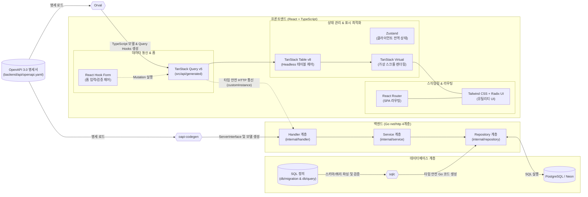

# Eventer Map Project Guidelines (API-First Architecture)

이 문서는 Eventer Map 프로젝트를 위한 AI 에이전트 커스텀 룰입니다.
본 프로젝트는 **OpenAPI 명세서(`backend/api/openapi.yaml`)**와 **SQL 정의(`backend/db/migration/`, `backend/db/query/`)**를 단일 진실 공급원(Single Source of Truth)으로 삼아, 백엔드와 프론트엔드 코드를 자동 생성하는 **E2E(End-to-End) 타입 안전 풀스택 아키텍처**를 채택하고 있습니다.

---

## 1. 🏗️ 시스템 아키텍처 및 데이터 흐름

---

## 2. 🛠️ 백엔드 아키텍처 및 기술 스택 (Go)

### 2.1. 4단계 계층형 아키텍처 (단방향 의존: Handler ➔ Service ➔ Repository)
- **`cmd/server/`**: 애플리케이션 진입점, 환경변수 로드, DB 연결, 의존성 주입(DI), 로컬(`net/http`) 및 AWS Lambda 프록시 실행.
- **`internal/middleware/`**: 로깅(`Logger`), CORS, 인증(`AuthMiddleware`) 등 공통 처리. 모든 미들웨어는 표준 `http.Handler` 패턴을 준수합니다.
- **`internal/handler/`**: HTTP 라우팅 바인딩, 요청 파라미터 파싱/검증 및 응답 반환. **비즈니스 로직 작성을 금지**하며, `oapi-codegen`이 생성한 `ServerInterface`를 구현합니다.
- **`internal/service/`**: 핵심 도메인 비즈니스 로직. HTTP 요청/응답 객체(`http.Request` 등)에 의존하지 않는 순수 Go 타입만 다루며, 모든 메서드의 첫 번째 인자는 `ctx context.Context`여야 합니다.
- **`internal/repository/`**: `sqlc`가 생성한 DB 접근 계층. 수동으로 수정하지 않으며 오직 `db/query/*.sql`과 `sqlc generate`를 통해서만 갱신합니다.

### 2.2. 백엔드 핵심 기술 규칙
- **Go Standard Library (`net/http`)**: Echo, Gin, Fiber 등 외부 웹 프레임워크 사용을 엄격히 금지합니다.
- **oapi-codegen**:
  - `backend/api/openapi.yaml`로부터 `internal/handler/openapi.gen.go`(`types`, `std-http`, `spec`)를 생성합니다.
  - 라우팅/인터페이스 생성 코드(`openapi.gen.go`)와 실제 핸들러 구현체(`*_handler.go`)가 분리되어 있으므로, 명세 변경 후 재성성을 실행해도 기존 핸들러 구현이 덮어써지지 않습니다.
- **sqlc**:
  - ORM(GORM 등) 사용을 금지합니다.
  - `db/migration/*.sql`과 `db/query/*.sql`을 컴파일 타임에 검증하여 런타임 오버헤드 없는 타입 안전 Go 구조체 및 쿼리 함수를 `internal/repository/`에 생성합니다.
- **golang-migrate**:
  - DB 스키마 변경 시 반드시 `db/migration/` 하위에 신규 마이그레이션 파일(`.up.sql`, `.down.sql`)을 생성합니다. **이미 적용된 기존 마이그레이션 파일은 절대 수정하지 않습니다.**

---

## 3. 🎨 프론트엔드 아키텍처 및 기술 스택 (React + TypeScript)

| 라이브러리 / 도구 | 역할 | 사용 규칙 및 아키텍처 지침 |
| :--- | :--- | :--- |
| **Orval** | API 클라이언트 자동 생성 | `backend/api/openapi.yaml`을 파싱하여 `src/api/generated/model`에 TypeScript 타입을, `src/api/generated/<tag>/`에 TanStack Query 커스텀 훅을 `tags-split` 모드로 자동 생성합니다. **수동으로 Axios 호출 코드를 작성하거나 `src/api/generated/` 내부 파일을 직접 수정하지 마십시오.** |
| **TanStack Query (v5)** | 서버 상태 관리 | API 데이터 캐싱, 백그라운드 패칭, 중복 요청 제거, 낙관적 업데이트(Optimistic Update), 로딩/에러 상태를 전담합니다. **서버에서 가져온 데이터를 Zustand 등 클라이언트 전역 스토어에 중복 저장하지 마십시오.** |
| **TanStack Table (v8)** | 데이터 테이블 제어 (Headless) | 페이지네이션, 정렬, 필터링, 행 선택 등 복잡한 테이블 로직은 UI와 분리된 Headless 훅으로 제어하고, 마크업은 Tailwind CSS로 구성합니다. |
| **TanStack Virtual** | 가상 스크롤 최적화 | 대량 데이터(수백~수만 건의 이벤트, 아티스트, 이력 등) 리스트/테이블 렌더링 시 뷰포트(Viewport)에 보이는 DOM 노드만 렌더링하여 메모리 고갈 및 렌더링 지연을 방지합니다. |
| **React Hook Form** | 폼 입력 및 검증 제어 | 비제어 컴포넌트(Uncontrolled Component) 기반으로 타이핑 시 불필요한 리렌더링을 방지합니다. 폼 제출 시 Orval이 생성한 `usePost*` / `usePut*` / `usePatch*` Mutation 훅과 연동합니다. |
| **Zustand** | 클라이언트 전역 상태 관리 | 서버 데이터 외의 **순수 클라이언트 상태**(선택된 이벤트 마커, 사이드바/모달 개폐 상태, 토스트 알림 등)만 `src/store/` 하위에서 최소한의 보일러플레이트로 관리합니다. |
| **Tailwind CSS & Radix UI** | 스타일링 & UI 프리미티브 | 유틸리티 퍼스트 CSS와 Headless UI 프리미티브(`src/components/ui/`)를 조합하여 일관된 디자인을 구축합니다. 클래스 병합 시 `src/lib/utils.ts`의 `cn()` 유틸리티를 사용합니다. |
| **React Router** | 클라이언트 라우팅 | SPA 화면 전환, URL 쿼리/파라미터 상태 동기화, 중첩 레이아웃(Nested Routes)을 관리합니다. |

---

## 4. 💾 데이터베이스 & sqlc 작성 규칙

1. **커서 기반 페이지네이션 (Cursor Pagination)**:
   - 무한 스크롤 및 대용량 고속 조회를 위해 `LIMIT + OFFSET`을 지양하고, **`WHERE id > @cursor_id` (또는 타임스탬프/복합 커서) 방식**을 적용합니다.
2. **조건부 업데이트 (Conditional Update)**:
   - 일부 필드만 선택적으로 수정하는 쿼리는 `sqlc.narg()`와 `COALESCE()`를 결합하여 작성합니다.
3. **sqlc 매직 주석 필수**:
   - `db/query/*.sql`의 모든 쿼리 상단에는 반드시 `-- name: <FuncName> <:one|:many|:exec|:execrows>` 형식의 어노테이션을 명시합니다.
4. **외래키 정책 (Foreign Key)**:
   - 유저 탈퇴 시에도 보존되어야 하는 핵심 도메인 엔티티(이벤트, 공연장, 아티스트, 히스토리 등)의 작성자 참조는 `ON DELETE CASCADE` 대신 **`ON DELETE SET NULL`**을 사용합니다.
5. **인덱스 최적화**:
   - 전방 일치 검색/자동완성은 `varchar_pattern_ops`, 지도 좌표 반경/영역 검색은 Box/공간 인덱스 등을 고려하여 설계합니다.

---

## 5. 🔐 인증 및 보안 (Auth)

- **자체 JWT (Bearer Token) 이중 토큰 구조**:
  - **Access Token**: 로그인/토큰 갱신 응답의 JSON Body로 전달받아 클라이언트 메모리(`src/lib/axios.ts`의 `accessToken` 변수)에만 보관합니다 (CSRF 및 XSS 토큰 탈취 방어).
  - **Refresh Token**: `HttpOnly`, `Secure` 쿠키로 저장하며 Axios 인스턴스의 `withCredentials: true` 설정을 통해 전송합니다 (XSS 방어).
- **백엔드 인가 처리**:
  - `internal/middleware/auth.go`에서 Bearer 토큰을 검증한 뒤 `context.WithValue`로 유저 정보를 주입하고, 핸들러/서비스 계층에서 Context를 통해 추출합니다.

---

## 6. 🔄 표준 코드 생성 및 개발 워크플로우

- **API 명세 변경 시 (`add-new-api` 스킬 참조)**:
  1. `backend/api/openapi.yaml` 수정 (`operationId`를 명확한 CamelCase로 지정)
  2. 백엔드 코드 생성: `cd backend && make generate` (`internal/handler/openapi.gen.go` 갱신)
  3. 프론트엔드 코드 생성: `cd frontend && npm run generate:api` (`src/api/generated/` 갱신)
  4. 백엔드 `internal/handler/` ➔ `internal/service/` 구현 및 프론트엔드 컴포넌트 바인딩
- **DB 스키마 및 쿼리 변경 시 (`modify-db-schema` 스킬 참조)**:
  1. `backend/db/migration/`에 신규 `.up.sql` / `.down.sql` 생성 후 `cd backend && make migrateup`
  2. `backend/db/query/*.sql`에 쿼리 작성 후 `cd backend && make generate` (`sqlc generate` 실행)
  3. `internal/repository/`에 생성된 타입/메서드를 `internal/service/`에서 호출
- **프론트엔드 기능 개발 시 (`develop-frontend-feature` 스킬 참조)**:
  - Orval 생성 훅(`TanStack Query`) + `React Hook Form` + `Zustand` + `TanStack Table / Virtual` 조합 패턴을 준수합니다.
