# Eventer Map Project Guidelines (API-First Architecture)

이 문서는 Eventer Map 프로젝트를 위한 AI 에이전트 커스텀 룰입니다.
본 프로젝트는 **OpenAPI 명세서(`backend/api/openapi.yaml`)**와 **SQL 정의(`backend/db/migration/`, `backend/db/query/`)**를 단일 진실 공급원(Single Source of Truth)으로 삼아, 백엔드와 프론트엔드 코드를 자동 생성하는 **E2E(End-to-End) 타입 안전 풀스택 아키텍처**를 채택하고 있습니다.

---

## 1. 🏗️ 시스템 아키텍처 및 데이터 흐름

```mermaid
flowchart LR
    subgraph DB_Layer["데이터베이스 & 상태 저장소"]
        SQLFiles[("SQL 정의<br/>(db/migration & db/query)")]
        SQLC{{"sqlc"}}
        DB[(PostgreSQL / NAS)]
        DDB[(DynamoDB<br/>OAuthStatesTable)]
        S3[(AWS S3<br/>Media Bucket)]
    end

    subgraph Backend_Layer["백엔드 (Go net/http + AWS Lambda)"]
        Handler["Handler 계층<br/>(internal/handler)"]
        Service["Service 계층<br/>(internal/service)"]
        Repo["Repository 계층<br/>(internal/repository)"]
        Support["인프라 계층<br/>(auth / storage / mailer)"]
    end

    GoCodegen{{"oapi-codegen"}}
    OpenAPI[("OpenAPI 3.0 명세서<br/>(backend/api/openapi.yaml)")]
    Orval{{"Orval"}}

    subgraph Frontend_Layer["프론트엔드 (React 18 + TypeScript)"]
        direction TB
        subgraph FE_Data["서버 상태 & API 훅"]
            TSQuery["TanStack Query v5<br/>(src/api/generated)"]
        end
        subgraph FE_State["UI 상태 & 제어"]
            ReactState["React Compiler + useState<br/>(sessionStorage 드래프트)"]
            Zustand["Zustand v5<br/>(src/store: UI·지도·토스트)"]
        end
        subgraph FE_UI["지도 · 스타일링 · 라우팅 · i18n"]
            MapUI["Google Maps + OSM Nominatim<br/>(@react-google-maps/api)"]
            Tailwind["Tailwind CSS + Radix UI<br/>(react-day-picker / i18next)"]
            Router["React Router v7<br/>(URL 쿼리 필터 동기화)"]
        end
    end

    SQLFiles -->|"스키마/쿼리 파싱 및 검증"| SQLC
    SQLC -->|"타입 안전 Go 코드 생성"| Repo
    Handler --> Service --> Repo
    Service --> Support
    Repo <-->|"SQL 실행"| DB
    Support <-->|"OAuth PKCE/State"| DDB
    Support <-->|"이미지 업로드"| S3

    OpenAPI -->|"명세 로드"| GoCodegen
    GoCodegen -->|"ServerInterface 및 모델 생성"| Handler

    OpenAPI -->|"명세 로드"| Orval
    Orval -->|"TypeScript 모델 & Query Hooks 생성"| TSQuery

    ReactState <--> TSQuery
    Zustand --- ReactState
    MapUI --- Zustand
    Router --- Tailwind
    TSQuery -.->|"타입 안전 HTTP 통신 (customInstance)"| Handler
```

---

## 2. 🛠️ 백엔드 아키텍처 및 기술 스택 (Go)

### 2.1. 계층형 아키텍처 (단방향 의존: Handler ➔ Service ➔ Repository)
- **`cmd/server/`**: 애플리케이션 진입점, 환경변수 로드, 서버리스 최적화 DB 커넥션 풀(`MaxOpenConns=2`, `MaxIdleConns=1`, `ConnMaxLifetime=5m`, `ConnMaxIdleTime=1m`), 의존성 주입(DI), 로컬(`net/http`) 및 AWS Lambda 프록시 실행.
- **`internal/middleware/`**: 로깅(`Logger`), CORS, 인증(`AuthMiddleware`) 등 공통 처리. 모든 미들웨어는 표준 `http.Handler` 패턴을 준수하며, `AuthMiddleware`는 `x_reauth`/`refresh` 토큰의 API Bearer 오용을 차단하고 `UserIDKey`를 `r.Context()`에 주입합니다.
- **`internal/handler/`**: HTTP 라우팅 바인딩, 요청 파라미터 파싱/검증 및 응답 반환(`RespondJSON`, `RespondError`, 다국어 에러 코드 매핑용 `RespondErrorCode`). **비즈니스 로직 작성을 금지**하며, `oapi-codegen`이 생성한 `ServerInterface`를 도메인별 `*_handler.go`에 구현합니다.
- **`internal/service/`**: 핵심 도메인 비즈니스 로직. HTTP 요청/응답 객체(`http.Request` 등)에 의존하지 않는 순수 Go 타입만 다루며, 모든 메서드의 첫 번째 인자는 `ctx context.Context`여야 합니다.
- **`internal/repository/`**: `sqlc`가 생성한 DB 접근 계층. **절대 수동 수정하지 않으며** 오직 `db/query/*.sql`과 `make generate`(`sqlc generate`)를 통해서만 갱신합니다.
- **인프라 지원 계층**:
  - **`internal/auth/`**: X OAuth 2.0 Confidential Client (PKCE `S256`) 및 `OAuthStateStore` (프로덕션 `DynamoDBOAuthStateStore` TTL + 조건부 `DeleteItem`, 로컬 개발 전용 인메모리 폴백).
  - **`internal/storage/`**: AWS S3 프로필 이미지 업로드(`Uploader`).
  - **`internal/mailer/`**: 이메일 인증 코드 발송(`SMTP` / 로컬 `MockMailer`).

### 2.2. 백엔드 핵심 기술 및 서버리스 제약 규칙
- **Go Standard Library (`net/http`)**: Echo, Gin, Fiber 등 외부 웹 프레임워크 사용을 엄격히 금지합니다.
- **oapi-codegen & sqlc (자동 생성 코드 보존)**:
  - `oapi-codegen`, `sqlc`, `migrate` 바이너리는 `/home/parkkh/go/bin`에 설치되어 있으며 `backend/Makefile`의 `PATH`를 통해 실행됩니다.
  - `internal/handler/openapi.gen.go`(`types`, `std-http`, `spec`)와 `internal/repository/*.go`는 **절대 수동으로 편집하지 않으며**, 생성 누락을 우회하기 위한 별도 wrapper 파일도 만들지 않습니다.
- **ORM 금지 (`sqlc`)**: GORM 등 ORM 사용을 금지하며 `db/migration/*.sql`과 `db/query/*.sql`을 컴파일 타임에 검증해 코드를 생성합니다.
- **AWS Lambda 서버리스 제약**: 상주 백그라운드 고루틴에 의존하지 않습니다. 주기적 상태 전이(예: 24시간 신용/신뢰 점수 판정)는 `CreditService.MaybeProcessSustainedLifecycle(ctx)`와 같이 API 요청 시점에 동작하는 **30초 스로틀링 지연 평가(Lazy Evaluation)** 패턴을 따릅니다.
- **golang-migrate**: DB 스키마 변경 시 반드시 `db/migration/` 하위에 신규 마이그레이션 파일(`.up.sql`, `.down.sql`)을 생성합니다. **이미 적용된 기존 마이그레이션 파일은 절대 수정하지 않습니다.**

---

## 3. 🛡️ 데이터 거버넌스 정책 (신용 점수 & 수정 요청)

- **이원화 상태 모델 (`events`, `artists`, `venues`)**:
  - 일반 유저(`role = 'USER'`) 등록 엔티티는 `status = 'PENDING'`, 관리자(`role = 'ADMIN'`) 등록 엔티티는 `status = 'APPROVED'`로 생성됩니다.
- **`PENDING` (유저 데이터)**:
  - 작성자 본인 또는 관리자만 직접 수정(`PUT`)·삭제(`DELETE`)할 수 있습니다.
  - 작성자 제외 활성 유저가 신용 점수 투표(`PUT .../{id}/credit`, `+1`/`-1`/`0`)를 행사할 수 있으며, 최소 5표 이상 및 순점수 `+5` 이상이 24시간 유지되면 `APPROVED`로 승격되고, `-5` 이하가 24시간 유지되면 자동 삭제됩니다.
- **`APPROVED` (공인 데이터)**:
  - 관리자만 직접 수정·삭제할 수 있습니다.
  - 일반 유저는 **수정 요청(`POST /modification-requests`)**으로 변경을 제안하며, 커뮤니티 신뢰 점수 투표(`PUT /modification-requests/{requestId}/trust`)에서 `+5` 이상이 24시간 유지되면 자동 반영(`APPLIED`), `-5` 이하가 24시간 유지되면 자동 삭제됩니다.
- **정지 계정(`is_banned = true`)**: 등록, 수정, 삭제, 신용/신뢰 투표, 수정 요청 등록이 모두 `403 Forbidden`으로 차단됩니다.

---

## 4. 🎨 프론트엔드 아키텍처 및 기술 스택 (React + TypeScript)

| 라이브러리 / 도구 | 역할 | 사용 규칙 및 아키텍처 지침 |
| :--- | :--- | :--- |
| **React 18 + React Compiler** | UI 렌더링 & 폼 제어 | CRACO(`craco.config.js`)에 `babel-plugin-react-compiler`가 활성화되어 있습니다. 폼은 제어 컴포넌트(`useState`)로 작성하며, 필요 시 `sessionStorage` 드래프트(`EventFormPane.tsx`)를 활용합니다. (`React Hook Form`, `TanStack Table`, `TanStack Virtual` 미사용) |
| **Orval** | API 클라이언트 자동 생성 | `backend/api/openapi.yaml`을 파싱해 `src/api/generated/model`에 TS 타입을, `src/api/generated/<tag>/`에 TanStack Query 훅을 `tags-split` 모드로 생성합니다. **수동 Axios 호출 작성 및 `src/api/generated/` 직접 수정을 금지합니다.** |
| **TanStack Query (v5)** | 서버 상태 관리 | `useQuery`, `useInfiniteQuery`(커서 기반 무한 스크롤), `useMutation`(낙관적 업데이트 및 `getGet*QueryKey()` 캐시 무효화)을 전담합니다. **서버 데이터를 Zustand에 중복 저장하지 마십시오.** |
| **Zustand (v5)** | 클라이언트 전역 상태 | 선택된 이벤트(`selectedEvent`), 지도 뷰포트/이동 타깃(`mapBounds`, `mapCenterTarget`), 회장 좌표 피킹 상태, 토스트 알림(`useToastStore`) 등 **순수 클라이언트 상태만** `src/store/`에서 관리합니다. |
| **Google Maps + OSM Nominatim** | 지도 & 지오코딩 | `@react-google-maps/api`로 지도를 렌더링하며, 장소 검색 시 Google Places/Geocoder 실패에 대비해 OpenStreetMap Nominatim 폴백을 제공합니다. |
| **Tailwind CSS + Radix UI** | 스타일링 & UI 프리미티브 | `src/components/ui/` 프리미티브와 `react-day-picker` v10을 재사용하며, 클래스 병합 시 `src/lib/utils.ts`의 `cn()` 유틸리티를 사용합니다. |
| **React Router (v7)** | 라우팅 & URL 동기화 | URL 쿼리(`?start=&end=`, `artistId`, `venueId`, `myAction`, `followingArtists`, `newEventsSince`)와 지도 필터를 동기화하고 `/auth/x/callback`을 처리합니다. |
| **i18next & API 에러 현지화** | 다국어 & 에러 처리 | UI 문구는 `src/i18n/locales/{ko,ja,en,zh}.json` 4개 국어를 동시 관리합니다. API 에러 토스트는 `toast.apiError(err, fallback)`(`useToastStore.ts` + `apiError.ts`)를 사용해 백엔드 에러 `code` 현지화와 중복 토스트(`_toastShown`) 방지를 적용합니다. |

- **Import 경로 규칙**: `frontend/tsconfig.json`에는 `"baseUrl": "src"`만 설정되어 있고 `@/*` 경로 별칭이 없으므로, 컴포넌트/훅 import 시 상대 경로(`../../api/generated/...` 등)를 사용합니다.

---

## 5. 💾 데이터베이스 & sqlc 작성 규칙

1. **커서 기반 페이지네이션 (Cursor Pagination)**:
   - 대량 목록 조회 시 `LIMIT + OFFSET`을 지양하고, **`WHERE id > @cursor_id`** 또는 **복합 튜플 커서**(`(t.recommend_count, t.created_at, t.id) < (...)`) 방식을 적용합니다.
2. **조건부 업데이트 (Conditional Update)**:
   - 일부 필드만 선택적으로 수정하는 쿼리는 `sqlc.narg()`와 `COALESCE()`를 결합하여 작성합니다.
3. **sqlc 매직 주석 필수**:
   - `db/query/*.sql`의 모든 쿼리 상단에는 반드시 `-- name: <FuncName> <:one|:many|:exec|:execrows>` 어노테이션을 명시합니다.
4. **외래키 정책 (Foreign Key)**:
   - 유저 탈퇴 시에도 보존되어야 하는 핵심 도메인 엔티티(`events`, `venues`, `artists`, `event_threads`, `modification_requests`)의 작성자 참조는 `ON DELETE CASCADE` 대신 **`ON DELETE SET NULL`**을 사용합니다.
5. **인덱스 및 쿼리 최적화**:
   - 전방 일치 자동완성은 `LOWER(official_name) varchar_pattern_ops` / `hiragana varchar_pattern_ops` B-Tree 인덱스를 활용합니다.
   - 커뮤니티·목록 조회 시 차단 유저는 `NOT EXISTS (SELECT 1 FROM user_blocks ...)`로 SQL 레벨에서 양방향 제외하고, 다중 조인 중복 방지는 `WITH ... AS (SELECT DISTINCT ...)` CTE 패턴을 사용합니다.

---

## 6. 🔐 인증 및 보안 (Auth)

- **자체 JWT (Bearer Token) 이중 토큰 구조**:
  - **Access Token**: 로그인/토큰 갱신 응답의 JSON Body로 전달받아 클라이언트 메모리(`src/lib/axios.ts`의 `accessToken` 변수)에만 보관합니다 (CSRF 및 XSS 토큰 탈취 방어).
  - **Refresh Token**: `HttpOnly`, `Secure` 쿠키로 저장하며 Axios 인스턴스의 `withCredentials: true` 설정을 통해 전송합니다 (XSS 방어).
- **지원 인증 수단 및 세션 격리**:
  - 자체 이메일/비밀번호(6자리 이메일 코드 검증), Google OAuth, X OAuth 2.0 + PKCE(팝업 `BroadcastChannel('eventer-map-x-oauth')` 및 풀페이지 리다이렉트 폴백)를 지원합니다.
  - 로그아웃 및 회원 탈퇴 시 `AuthContext.tsx`의 `clearPrivateClientState()`로 `/users/me*` 및 개인화 `/events`(`myAction`, `followingArtists`) 캐시를 즉시 제거합니다.

---

## 7. 🔄 표준 코드 생성 및 개발 워크플로우

- **API 명세 변경 시 (`add-new-api` 스킬 참조)**:
  1. `backend/api/openapi.yaml` 수정 (`operationId`를 명확한 `camelCase`로 지정, `tags` 명시)
  2. 루트에서 `make generate` 실행 (또는 `cd backend && make generate` 후 `cd frontend && npm run generate:api`)
  3. 백엔드 `internal/handler/` ➔ `internal/service/` 구현 및 프론트엔드 컴포넌트 바인딩
- **DB 스키마 및 쿼리 변경 시 (`modify-db-schema` 스킬 참조)**:
  1. `backend/db/migration/`에 신규 `.up.sql` / `.down.sql` 생성 후 `cd backend && make migrateup`
  2. `backend/db/query/*.sql`에 쿼리 작성 후 `cd backend && make generate` (`sqlc generate` 실행)
  3. `internal/repository/`에 생성된 타입/메서드를 `internal/service/`에서 호출
- **프론트엔드 기능 개발 시 (`develop-frontend-feature` 스킬 참조)**:
  - Orval 생성 훅(`TanStack Query v5`) + React Compiler/`useState` + `Zustand v5` + `i18next` 4개 국어 + `toast.apiError` 패턴을 준수합니다.
