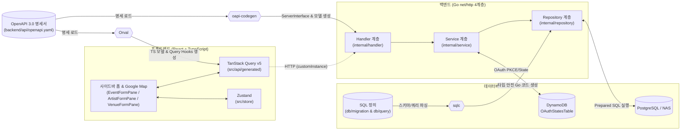

# 🏗️ Eventer Map 시스템 아키텍처 (System Architecture)

[⬅️ 홈으로 돌아가기](./Home.md) | [관련 문서: 기술 스택](./TECH_STACK.md) | [AWS 배포 가이드](./AWS_DEPLOYMENT_GUIDE.md)

이 문서는 Eventer Map의 **API-First 풀스택 아키텍처**, 백엔드 4계층 구조, 그리고 프론트엔드 상태·폼·지도 연동 설계를 설명합니다.

---

## 1. 🌐 전체 시스템 및 코드 생성 흐름 (Single Source of Truth)

본 프로젝트는 **OpenAPI 명세서(`backend/api/openapi.yaml`)**와 **SQL 정의(`backend/db/migration/`, `backend/db/query/`)**를 단일 진실 공급원으로 삼아 백엔드와 프론트엔드 코드를 자동 생성합니다.

---

## 2. 📂 백엔드 4단계 계층 구조 (`backend/`)

모든 의존성은 **Handler ➔ Service ➔ Repository** 단방향으로만 흐릅니다.

### 1) `cmd/server/` (진입점 & 의존성 주입)
- 환경변수 로드, 서버리스 환경에 최적화된 PostgreSQL 커넥션 풀 초기화(`MaxOpenConns=2`, `MaxIdleConns=1`, `ConnMaxLifetime=5m`, `ConnMaxIdleTime=1m`), `Repository ➔ Service ➔ Handler` 조립 및 로컬(`net/http`)/AWS Lambda 프록시 실행을 담당합니다.

### 2) `internal/middleware/` (공통 처리 계층)
- 표준 `http.Handler` 래핑 패턴으로 구현되어 있습니다.
  - `logger.go`: 요청 메서드, 경로, 소요 시간 로깅
  - `auth.go`: `Authorization: Bearer <token>` 검증(`x_reauth`/`refresh` 토큰 오용 차단) 및 `context.WithValue`를 통한 `UserIDKey` 주입
  - `cors.go`: 브라우저 CORS 헤더 및 Preflight(`OPTIONS`) 처리

### 3) `internal/auth/` (외부 OAuth & PKCE 저장소)
- `x_oauth.go`: X OAuth 2.0 Confidential Client (Basic Auth + PKCE `S256` 코드 검증기/챌린지 생성, 토큰 교환, `/2/users/me` 프로필 조회)
- `oauth_state_store.go`: `OAuthStateStore` 인터페이스 구현체 — 프로덕션용 `DynamoDBOAuthStateStore` (TTL + 조건부 `DeleteItem` 원자 1회 소비) 및 로컬(`ENV=local` / 비-Lambda) 전용 `InMemoryOAuthStateStore`

### 4) `internal/handler/` (표현 계층)
- `oapi-codegen`이 생성한 `openapi.gen.go`의 `ServerInterface`를 도메인별 파일(`event_handler.go`, `thread_handler.go`, `artist_handler.go`, `venue_handler.go`, `auth_handler.go`, `user_handler.go` 등)에서 구현합니다.
- 요청 파라미터/바디 파싱 및 입력값 검증(필수값, 본문 및 문자열 길이, 바디 크기 제한, 위경도 범위, 이미지 MIME/용량 등)만 수행하고 비즈니스 로직은 `Service`에 위임합니다.

### 5) `internal/service/` (비즈니스 계층)
- HTTP 객체(`http.Request` 등)에 의존하지 않는 순수 Go 도메인 로직을 수행합니다.
- 유저 권한(`ADMIN` 여부)에 따른 등록 상태 결정(`PENDING` vs `APPROVED`), 이벤트 평점/수정 시 공연장 및 출연자의 평균 평점 캐시(`rating_sum`, `rating_count`) 재계산, 스레드 복합 커서 인코딩/디코딩, 본인 스레드 추천 방지, 트랜잭션 처리를 담당합니다.
- 인증/계정 도메인(`auth_service.go`, `x_auth_service.go`, `user_service.go`)에서는 이메일 인증 코드 검증, Google/X OAuth 로그인·계정 연동·해제(마지막 로그인 수단 해제 방지), 이메일 없는 X 가입(`NULL` 이메일 + 유니크 닉네임 자동 생성), 탈퇴 재인증 검증을 수행합니다.

### 6) `internal/repository/` (데이터 접근 계층)
- `sqlc`가 `db/migration/*.sql`과 `db/query/*.sql`을 컴파일 타임에 검증하여 자동 생성한 패키지입니다.

---

## 3. 🎨 프론트엔드 좌측 사이드바, 인증 UX & 지도 연동 아키텍처 (`frontend/`)

- **X OAuth 콜백 및 팝업 통신 (`lib/xOAuth.ts`, `pages/XOAuthCallbackPage.tsx`)**: `window.open` 팝업과 동일 오리진 `BroadcastChannel('eventer-map-x-oauth')`를 사용해 지도 상태나 `ProfileSettingsModal`을 유지한 채 인증을 처리하며, 팝업 차단 환경(모바일 인앱 브라우저 등)에서는 `sessionStorage` 임시 상태를 이용한 풀페이지 리다이렉트로 폴백합니다.

지도 화면(`MapPage.tsx`)은 **좌측 사이드바 패널(20%)**과 **우측 인터랙티브 지도(`EventMap.tsx`, 80%)**로 구성됩니다.

### 1) 좌측 사이드바 단일 컨테이너 전환 구조
좌측 사이드바는 별도의 모달 팝업을 띄우지 않고, 상황에 따라 패널 컴포넌트를 매끄럽게 전환합니다:
- **기본 목록 뷰**: 날짜 필터(`DatePicker`), 출연자 필터(`ArtistSearch`), 이벤트 목록(`EventList`)
- **이벤트 상세 뷰 (`EventDetailPane.tsx`)**:
  - 지도 마커 또는 리스트에서 이벤트 선택 시 상세 정보 및 출연자(`공식 이름 (식별 설명)`) 표시
  - 체크/참가 상태 원클릭 순환(`usePutEventsEventIdAction`)
  - **이벤트 스레드 & 커뮤니티 서브 섹션 (`EventThreadSection.tsx`)**:
    - **추천순 랭킹 & BEST 뱃지**: 추천 수가 많은 고품질 스레드가 상단에 정렬되며 상위 스레드에 BEST 뱃지 표시
    - **커서 기반 무한 스크롤**: TanStack Query v5 `useInfiniteQuery`를 활용한 지연 로딩
    - **낙관적 업데이트 (Optimistic Update)**: 추천/추천 취소 토글 시 UI에 즉각 반영하고 오류 발생 시 롤백
    - **스레드 작성 & 본인 글 제어**: 1~1,000자 실시간 카운팅, 본인 작성 글 식별 및 삭제 확인 UI 제공 (XSS 방지를 위한 React JSX 안전 텍스트 바인딩)
- **새 이벤트 등록 뷰 (`EventFormPane.tsx`)**:
  - 작성 중인 모든 폼 상태를 브라우저 `sessionStorage`(`eventer_map_event_form_draft`)에 실시간 보존합니다.
  - **`'회장'` 및 `'출연자'` 저부하 자동완성**:
    - `300ms` 디바운스 + IME 조합(`isComposing`) 가드 + TanStack Query 5분 캐시(`staleTime`)로 서버 부하를 최소화합니다.
    - 일치하는 항목이 없으면 자동완성 드롭다운 **최하단**에 `"{검색어}" 회장 추가` / `"{검색어}" 출연자 추가` 버튼을 노출합니다.
  - **신규 출연자 등록 서브 뷰 (`ArtistFormPane.tsx`)**:
    - 좌측 상단 `'뒤로가기'` 버튼, 공식 이름, 히라가나, 동명이인 구분용 식별 설명(`disambiguation`), 성별(`여성`/`남성`), 프로필 이미지(최대 5MB, JPG/PNG) 업로드를 지원하며, 등록 완료 시 이벤트 폼의 출연자 목록에 즉시 추가됩니다.
  - **신규 회장 등록 서브 뷰 (`VenueFormPane.tsx`)**:
    - 좌측 상단 `'뒤로가기'` 버튼, 장소 검색 자동 입력, 공식 이름, 주소, 위도/경도, 수용 인원, 관련 링크 입력을 지원합니다.
    - **다단계 장소 검색 & 지도 클릭 연동**:
      1. Google Maps `PlacesService.textSearch` / `Geocoder`를 1차로 시도하고, API 키 권한 미활성화 시 **OpenStreetMap Nominatim 공개 API**로 자동 폴백하여 장소명·주소·위도·경도를 자동 입력합니다.
      2. 우측 지도(`EventMap.tsx`)를 직접 클릭하면 마커가 표시되면서 클릭 지점의 위도/경도와 역지오코딩 주소가 폼에 실시간 반영됩니다.
      3. 등록 완료 시 이벤트 폼으로 복귀하며 해당 회장이 즉시 선택됩니다.
