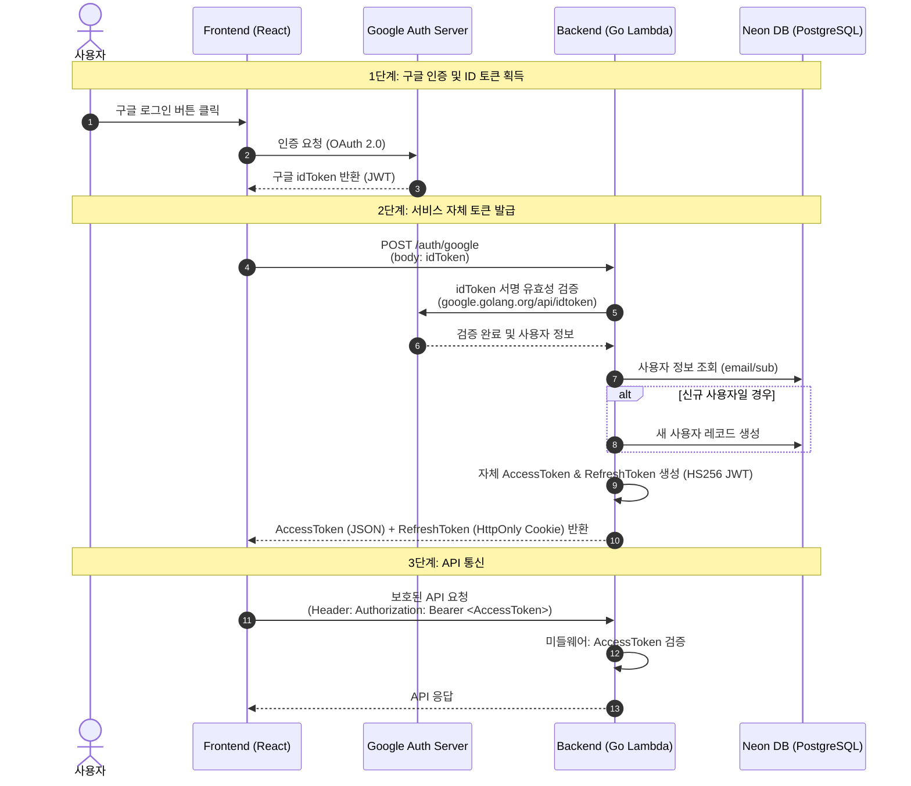
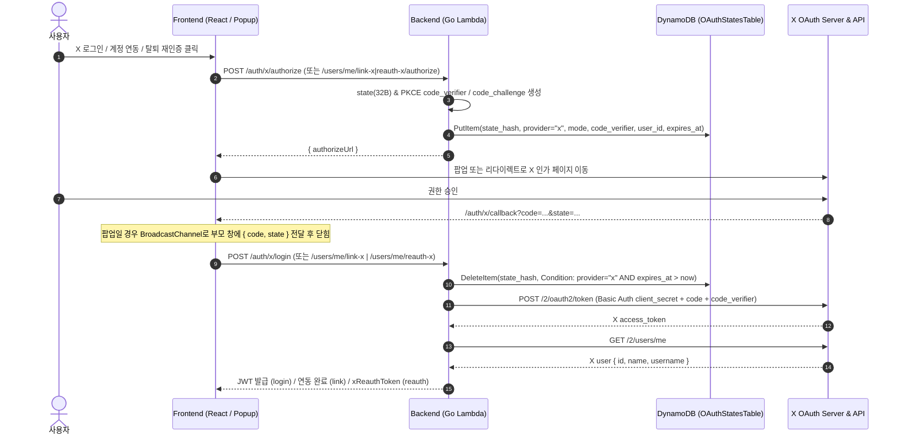

# 🔐 인증 아키텍처 & OAuth 플로우 (Google · X)

[⬅️ 홈으로 돌아가기](./Home.md) | [관련 문서: 이메일 인증 가이드](./EMAIL_VERIFICATION_GUIDE.md) | [API 상세 설계서](./API_SPECIFICATION.md)

프론트엔드(React)와 서버리스 백엔드(AWS Lambda, Go 표준 라이브러리) 환경에서의 소셜 인증(Google OAuth 2.0 & X OAuth 2.0 PKCE) 및 계정 연동 아키텍처입니다.

## 📌 1. Google OAuth 2.0 로그인·연동
- **프론트엔드 (React):** `@react-oauth/google`의 `useGoogleLogin`으로 구글로부터 `access_token`을 발급받아 백엔드에 전달합니다.
- **백엔드 (Go Lambda):** Google UserInfo/Token 검증 후 자체 JWT(`Access Token` JSON 바디 + `Refresh Token` `HttpOnly` 쿠키)를 발급합니다. 신규 가입 시 `is_email_verified = true`로 생성됩니다.

---

## 🗺️ 시퀀스 다이어그램 (Sequence Diagram)



---

## 🛠️ 백엔드(Go) 구현 핵심 포인트

**1. ID 토큰 검증 패키지**
Go 표준 라이브러리를 지향하더라도, 구글 토큰 검증은 보안상 매우 중요하므로 구글에서 공식 제공하는 `google.golang.org/api/idtoken` 패키지 사용을 권장합니다.

**2. 자체 JWT 토큰 설계**
- `Access Token`: 수명이 짧은 토큰 (예: 1시간). 매 API 요청 시 검증.
- `Refresh Token`: 수명이 긴 토큰 (예: 14일). `Access Token` 만료 시 갱신을 위해 사용. DB에 저장하여 언제든 강제 로그아웃(토큰 무효화) 처리 가능.

**3. 표준 라이브러리(`net/http`) 기반 미들웨어**
보호된 엔드포인트(예: 프로필 조회, 마커 생성 등)에 접근할 때 토큰을 검사할 수 있도록, Go의 표준 `http.Handler`를 감싸는 미들웨어(Middleware) 패턴을 작성해야 합니다.

```go
// 미들웨어 예시 뼈대
func AuthMiddleware(next http.Handler) http.Handler {
    return http.HandlerFunc(func(w http.ResponseWriter, r *http.Request) {
        // 1. Authorization 헤더 파싱
        // 2. JWT 서명 검증 및 만료 시간 확인
        // 3. context.WithValue를 이용해 파싱된 유저 정보를 Request Context에 담아 전달
        next.ServeHTTP(w, r)
    })
}
```

---

## 🐦 X (Twitter) OAuth 2.0 + PKCE (Confidential Client / BFF) 플로우

X OAuth 2.0은 브라우저(SPA)에서 직접 토큰을 교환하지 않고, **백엔드(Go Lambda)가 Confidential Client로 동작**하며 `client_secret`과 PKCE `code_verifier`를 서버 측에 보관합니다.

### 📌 핵심 설계 요약
- **OAuth State & PKCE 저장소**: 프로덕션(AWS Lambda)에서는 **DynamoDB(`OAuthStatesTable`, TTL + `DeleteItem` 조건부 원자 소비)**를 사용하여 컨테이너 간 상태 공유와 1회성 소비를 보장합니다. 로컬 개발 환경(`ENV=local` / 비-Lambda)에서는 `InMemoryOAuthStateStore`로 동작하며, 비-로컬 환경에서 `DYNAMODB_OAUTH_STATE_TABLE`이 누락되면 fail-closed 됩니다.
- **이메일 미수집 기본 정책**: 기본 스코프(`users.read tweet.read`)로 동작하므로 이메일 없이도 가입·연동이 가능합니다 (`users.email = NULL`). `X_REQUEST_EMAIL=true`로 설정한 경우에만 `confirmed_email`을 추가 요청합니다.
- **자동 닉네임 생성**: X 신규 가입 시 X `@username` 기반으로 2~30자 유니크 닉네임을 자동 생성(충돌 시 `_<4hex>` 접미사 부여)하며, 이후 프로필 설정에서 변경할 수 있습니다.
- **COOP 대응 팝업 + 리다이렉트 폴백**: 프론트엔드는 `window.open` 팝업과 동일 오리진 `BroadcastChannel('eventer-map-x-oauth')`를 사용해 X의 `Cross-Origin-Opener-Policy`로 `window.opener`가 끊기는 환경에서도 결과를 전달합니다. 팝업이 차단된 인앱 브라우저 등에서는 풀페이지 리다이렉트로 자동 전환됩니다.

### 🗺️ 시퀀스 다이어그램 (로그인 / 연동 / 탈퇴 재인증)



### 📊 Google vs X OAuth 아키텍처 비교

| 항목 | Google OAuth | X (Twitter) OAuth 2.0 |
| :--- | :--- | :--- |
| **클라이언트 유형** | Public SPA (`@react-oauth/google`) | **Confidential Client + PKCE (BFF)** (`internal/auth/x_oauth.go`) |
| **클라이언트 시크릿** | 사용 안 함 | **서버 전용** (`X_CLIENT_SECRET`, 브라우저 미노출) |
| **상태 저장소** | 라이브러리 내부 상태 처리 | **DynamoDB (`OAuthStatesTable`, TTL 10분)** / 로컬 인메모리 폴백 |
| **이메일 수집** | 필수 수집 | **이메일 없이 가입·연동 가능** (`email = NULL`, `X_REQUEST_EMAIL=true` 시 선택 수집) |
| **닉네임 초기화** | 이메일 주소 기반 | X `@username` 기반 2~30자 유니크 닉네임 자동 생성 (충돌 시 `_<4hex>`) |
| **브라우저 창 방식** | `@react-oauth/google` 팝업 | `window.open` 팝업 + `BroadcastChannel` (차단 시 풀페이지 리다이렉트 폴백) |

### 🛡️ 회원가입 · 로그인 · 계정 연동 · 탈퇴 보안 정책

1. **X 회원가입 및 로그인 (`POST /auth/x/authorize` ➔ `POST /auth/x/login`)**
   - 불변 식별자인 **`x_id`**를 기준으로 계정을 조회하며, 표시 핸들인 `x_username`이 변경된 경우 로그인 시 자동 동기화합니다.
   - `is_banned = true` 계정은 로그인을 차단합니다 (`403 ACCOUNT_BANNED`).
   - 기본 스코프(`users.read tweet.read`)에서는 이메일을 요청하지 않으므로 `users.email = NULL`, `is_email_verified = false`로 가입됩니다. 이메일이 없는 계정은 이메일+비밀번호 로그인을 할 수 없으므로 프로필 설정에서 비밀번호 설정이 비활성화되며 백엔드(`PUT /users/me/password`)에서도 차단됩니다 (`400 EMAIL_REQUIRED_FOR_PASSWORD`).
   - `X_REQUEST_EMAIL=true`로 확인된 이메일(`confirmed_email`)을 받은 경우에도 기존 가입 이메일과 충돌하면 자동 병합하지 않고 `409 EMAIL_CONFLICT`를 반환해 계정 탈취(Account Takeover)를 방지합니다.

2. **X 계정 연동 및 연동 해제 (`link-x` / `unlink-x`)**
   - 연동은 로그인한 상태에서만 시작(`POST /users/me/link-x/authorize`)할 수 있으며, `state_hash` 레코드에 `user_id`를 바인딩해 다른 사용자의 콜백 탈취(CSRF)를 차단합니다.
   - 이미 다른 계정에 연결된 X 계정이면 `409 X_ACCOUNT_CONFLICT`, 이미 현재 계정에 X가 연동되어 있으면 `400 X_ALREADY_LINKED`를 반환합니다.
   - **마지막 로그인 수단 해제 방지 (Lockout Prevention)**: `unlink-x` 및 `unlink-google` 모두 **사용 가능한 다른 로그인 수단**(Google/X 연동 또는 `email != NULL AND is_email_verified AND password_hash != NULL`)이 남아있는 경우에만 해제를 허용하며, 마지막 수단인 경우 `400 CANNOT_UNLINK_LAST_AUTH`로 거부합니다.

3. **회원 탈퇴 재인증 (`reauth-x` ➔ `DELETE /users/me`)**
   - 비밀번호가 없는 X 전용 계정(또는 Google+X 무비밀번호 계정)이 탈퇴할 때는 X 재인증(`mode="reauth"`)을 거쳐 **5분 유효·단일 목적 HS256 JWT(`type="x_reauth"`, `xReauthToken`)**를 발급받아 제출합니다.
   - 재인증 시 로그인한 계정과 다른 X 계정으로 인증하면 `403 X_ACCOUNT_MISMATCH`로 거부됩니다.
   - `AuthMiddleware`는 `type="x_reauth"` 또는 `type="refresh"` 토큰이 일반 API `Authorization: Bearer` 헤더로 오용되지 않도록 차단합니다.

4. **프론트엔드 팝업(COOP) & 리다이렉트 폴백 동작 (`lib/xOAuth.ts`, `pages/XOAuthCallbackPage.tsx`)**
   - 클릭 핸들러 안에서 **동기적으로 빈 팝업 창을 먼저 열고**(`window.open`), 백엔드가 내려준 `authorizeUrl`이 `https://x.com` 또는 `https://twitter.com` 오리진인지 검증한 뒤 이동합니다(브라우저 팝업 차단 회피 및 오픈 리다이렉트 방지).
   - X 인증 페이지의 `Cross-Origin-Opener-Policy`로 `window.opener` 참조가 끊기더라도 동일 오리진의 `/auth/x/callback`이 `BroadcastChannel('eventer-map-x-oauth')`로 `code`/`state`를 전달하고 부모 창 ACK 확인 후 창을 닫습니다.
   - 인앱 브라우저 등으로 팝업이 차단된 경우 `sessionStorage`(`eventer_x_oauth_pending`)에 `{ mode, state }`만 임시 저장하고 풀페이지 리다이렉트로 전환합니다. 복귀 시 `XOAuthCallbackPage`는 `link`/`reauth` 모드일 경우 `AuthProvider`가 `POST /auth/refresh`로 메모리에 `accessToken`을 복구(`isLoading === false`)할 때까지 대기한 뒤 후속 API를 호출합니다.
   - **Axios 401 세션 보호**: X OAuth `state` 만료나 토큰 교환 실패 시 백엔드는 `401` 대신 `400` (`X_OAUTH_STATE_INVALID`, `X_OAUTH_EXCHANGE_FAILED`)을 반환하여, 로그인된 사용자의 메모리 `accessToken`이 인터셉터에 의해 초기화되지 않도록 보호합니다.
