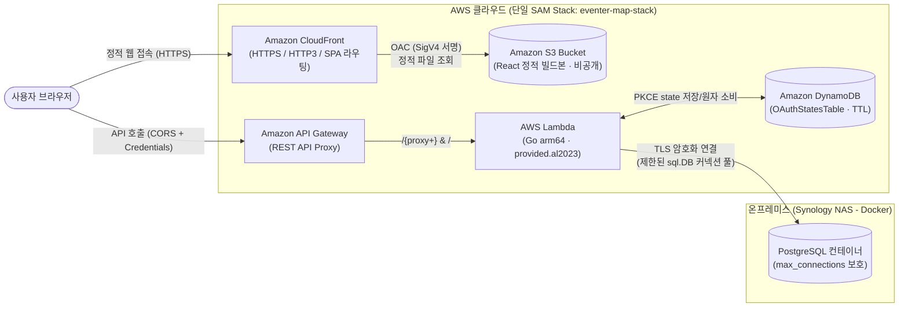

# ☁️ AWS 서버리스 & 정적 배포 가이드 (AWS Deployment Guide)

[⬅️ 홈으로 돌아가기](./Home.md) | [관련 문서: 시스템 아키텍처](./ARCHITECTURE.md) | [기술 스택](./TECH_STACK.md)

이 문서는 Eventer Map의 **프론트엔드(S3 + CloudFront OAC)**, **백엔드(AWS Lambda + API Gateway)**, **데이터베이스(NAS Docker PostgreSQL)** 하이브리드 서버리스 배포 아키텍처와 원클릭 배포/CI·CD 운영 방법을 설명합니다.

---

## 1. 🗺️ 배포 인프라 아키텍처



---

## 2. 🔧 1단계: 백엔드 서버리스 배포 대응 설계 (`backend/`)

### 2.1. Lambda ➔ NAS DB 커넥션 풀 제한 원리 (`cmd/server/main.go`)
상시 구동 서버(EC2 등)와 달리 **AWS Lambda는 동시 요청 수만큼 독립된 컨테이너(프로세스)가 각각 생성(Scale-out)**되며, 각 컨테이너는 요청이 끝난 뒤에도 수 분간 일시 정지(Freeze) 상태로 열린 TCP 커넥션을 유지합니다.

만약 Go `database/sql`의 기본값(`MaxOpenConns = 무제한`, `MaxIdleConns = 2`)을 그대로 사용하면 트래픽 급증 시 유휴/좀비 커넥션이 누적되어 NAS PostgreSQL(`max_connections=100`)이 고갈됩니다. 이를 방지하기 위해 `cmd/server/main.go`에 다음 4가지 제한을 적용합니다:

```go
db.SetMaxOpenConns(2)                  // 1) 단일 Lambda 컨테이너당 최대 활성 연결 수 제한
db.SetMaxIdleConns(1)                  // 2) Warm Start 재사용을 위해 유휴 연결은 딱 1개만 유지
db.SetConnMaxLifetime(5 * time.Minute) // 3) 공유기 NAT/방화벽 세션 타임아웃(broken pipe) 방지를 위해 5분마다 갱신
db.SetConnMaxIdleTime(1 * time.Minute) // 4) 1분 이상 놀고 있는 유휴 연결은 즉시 반환
```

| 설정 메서드 | 설정값 | 핵심 역할 및 기대 효과 |
| :--- | :--- | :--- |
| `SetMaxOpenConns` | `2` | Lambda 인스턴스 1개는 동시에 1개의 요청만 처리하므로 과도한 연결 생성을 원천 차단 |
| `SetMaxIdleConns` | `1` | 연속된 API 호출(Warm Start) 시 TCP/TLS 핸드셰이크 오버헤드를 제거하면서 유휴 연결을 절반으로 축소 |
| `SetConnMaxLifetime` | `5m` | AWS ➔ 외부 공유기(NAT) ➔ NAS 구간에서 유휴 TCP 세션이 방화벽에 의해 강제 종료되어 발생하는 `connection reset` 에러 방지 |
| `SetConnMaxIdleTime` | `1m` | 트래픽이 빠진 후 대기 중인 Lambda 컨테이너의 DB 연결을 신속히 회수 |

### 2.2. 프로덕션 쿠키(`refreshToken`) 보안 및 도메인 분기 (`internal/handler/auth_handler.go`)
- `buildRefreshTokenCookie()` 헬퍼를 통해 로컬(`ENV=local`)과 배포 환경(`ENV=prod`)의 쿠키 정책을 자동 분기합니다.
  - **`Secure` 플래그**: `ENV != "local"`일 때 자동으로 `Secure: true`가 적용되어 HTTPS 통신에서만 쿠키가 전송됩니다.
  - **`SameSite` 모드 (`COOKIE_SAMESITE`)**:
    - CloudFront 기본 도메인(`*.cloudfront.net`)과 API Gateway 기본 도메인(`*.execute-api.ap-northeast-2.amazonaws.com`)을 각각 사용할 경우 Cross-Origin 요청에서 쿠키가 전송되도록 `COOKIE_SAMESITE=None`(`Secure: true` 필수)을 지원합니다.
    - 커스텀 도메인(`eventermap.com` + `api.eventermap.com`)을 연결한 경우 `COOKIE_SAMESITE=Lax`와 `COOKIE_DOMAIN=.eventermap.com`으로 전환할 수 있습니다.

### 2.3. JWT 서명 시크릿 환경변수 분리 (`internal/service/auth_service.go`)
- `GetJWTSecret()` 함수가 `JWT_SECRET` 환경변수를 우선 로드하며, 설정되지 않은 로컬 개발 환경에서만 개발용 기본 키로 폴백합니다.

---

## 3. 🏗️ 2단계: AWS SAM 통합 인프라 템플릿 (`backend/template.yaml`)

별도의 서드파티 IaC 도구 없이 **`backend/template.yaml` 단일 파일**로 백엔드와 프론트엔드 리소스를 한 번에 관리합니다.

### 주요 프로비저닝 리소스
1. **`EventerMapApiFunction` (`AWS::Serverless::Function`)**:
   - **런타임/아키텍처**: `provided.al2023` + `arm64` (Graviton2 기반으로 x86 대비 가격 대비 성능 20% 이상 우수)
   - **빌드 방식**: `BuildMethod: makefile` (`GOOS=linux GOARCH=arm64 CGO_ENABLED=0 go build -tags lambda.norpc -ldflags="-s -w"`)로 바이너리 크기를 최소화하여 콜드 스타트를 단축합니다.
   - **최소 권한 IAM**: `MediaBucket` CRUD 권한과 `OAuthStatesTable`에 대한 `dynamodb:PutItem`, `dynamodb:DeleteItem` 권한만 부여합니다.
2. **`OAuthStatesTable` (`AWS::DynamoDB::Table`)**:
   - On-Demand(`PAY_PER_REQUEST`) 요금제, `state_hash` 파티션 키, `expires_at` TTL 자동 삭제 및 서버 측 암호화(`SSESpecification`)가 적용된 단기 OAuth PKCE/CSRF 상태 저장소입니다.
3. **`FrontendBucket` (`AWS::S3::Bucket`) + `FrontendBucketPolicy`**:
   - 모든 퍼블릭 액세스를 차단(`PublicAccessBlockConfiguration: true`)하고, 오직 CloudFront OAC를 통한 읽기(`s3:GetObject`)만 허용합니다.
3. **`FrontendOriginAccessControl` & `FrontendDistribution` (`AWS::CloudFront::Distribution`)**:
   - **HTTPS 강제 적용** (`ViewerProtocolPolicy: redirect-to-https`) 및 **HTTP/2 & HTTP/3** 활성화
   - **SPA 라우팅 지원 (`CustomErrorResponses`)**: React Router 경로(`/admin`, `/events/123` 등)로 직접 접속하거나 새로고침할 때 S3가 반환하는 `403`/`404` 응답을 `/index.html` (`200 OK`)로 변환하여 정상 렌더링합니다.
4. **X OAuth 콜백과 CloudFront 라우팅**:
   - X Developer Portal Callback URI를 `https://<프론트엔드 도메인>/auth/x/callback`으로 등록해야 합니다. CloudFront `CustomErrorResponses`로 S3 `403`/`404`를 `/index.html`로 서빙하므로 SPA 콜백 라우트가 정상 동작합니다.

---

## 4. 🚀 3단계: 원클릭 배포 스크립트 및 GitHub Actions CI/CD

### 4.1. 로컬 원클릭 배포 (`Makefile`)
루트 [`Makefile`](../Makefile)은 CloudFormation Stack Output(`EventerMapApi`, `FrontendBucketName`, `CloudFrontDistributionId`)을 자동으로 조회하여 수동 복사/붙여넣기 없이 배포를 수행합니다.

#### 프론트엔드 차등 캐싱 전략 (`make deploy-fe`)
- **해시된 정적 에셋 (`build/static/*`)**: 파일명에 콘텐츠 해시가 포함되므로 `Cache-Control: public, max-age=31536000, immutable` 헤더를 부여해 브라우저와 CloudFront에 **1년간 영구 캐싱**합니다.
- **엔트리 파일 (`index.html`, `asset-manifest.json`)**: 배포 즉시 새 버전을 가리켜야 하므로 `Cache-Control: no-cache, no-store, must-revalidate`를 부여하고, CloudFront 무효화(Invalidation)도 `/index.html`과 `/` 경로만 최소 실행하여 비용과 반영 시간을 절약합니다.

#### 명령어 요약
```bash
# 1. 최초 1회: backend/.env에 배포 환경변수 설정 후 백엔드 & 인프라 생성
make deploy-be

# 2. 생성된 CloudFront URL 및 API Gateway 엔드포인트 확인
make stack-outputs

# 3. 프론트엔드 빌드 + S3 동기화 + CloudFront 캐시 무효화
make deploy-fe

# 4. 이후 백엔드 + 프론트엔드 통합 배포 시
make deploy-all
```

### 4.2. GitHub Actions 자동 배포 (`.github/workflows/deploy.yml`)
`main` 브랜치에 코드가 푸시되면 아래 2개의 Job이 순차 실행됩니다:
1. **`deploy-backend`**:
   - AWS IAM OIDC(`aws-actions/configure-aws-credentials@v4`)로 임시 권한을 획득하고 `make deploy`를 실행하여 Lambda 및 인프라를 갱신합니다.
   - CloudFormation Stack Output에서 `api_url`, `s3_bucket`, `cf_dist_id`를 추출해 다음 Job으로 전달합니다.
2. **`deploy-frontend`**:
   - 전달받은 `api_url`을 `REACT_APP_API_URL`에 자동 주입하여 `npm run build`를 수행합니다.
   - S3 차등 캐싱 업로드 및 CloudFront 캐시 무효화를 자동으로 완료합니다.

#### GitHub Repository Secrets 등록 목록
| 구분 | 이름 | 설명 |
| :--- | :--- | :--- |
| **Secrets** | `AWS_ROLE_ARN` | GitHub OIDC 연동용 AWS IAM Role ARN |
| **Secrets** | `DATABASE_URL` | NAS PostgreSQL 접속 URL (`?sslmode=require&connect_timeout=5` 권장) |
| **Secrets** | `JWT_SECRET` | 프로덕션 JWT 서명 시크릿 키 |
| **Secrets** | `CORS_ORIGINS` | 허용할 프론트엔드 Origin (예: `https://d1234.cloudfront.net`) |
| **Secrets** | `COOKIE_SAMESITE` | 기본값 `None` (동일 루트 도메인 사용 시 `Lax`) |
| **Secrets** | `X_CLIENT_ID` | X Developer Portal OAuth 2.0 Client ID |
| **Secrets** | `X_CLIENT_SECRET` | X Developer Portal OAuth 2.0 Client Secret (백엔드 전용) |
| **Secrets** | `X_REDIRECT_URI` | X OAuth 2.0 Callback URL (`https://<도메인>/auth/x/callback`) |
| **Secrets** | `X_REQUEST_EMAIL` | 선택 사항 (`true` 설정 시 `users.email` 스코프 요청, 기본 `false`) |
| **Secrets** | `REACT_APP_GOOGLE_MAPS_API_KEY` | 프론트엔드 Google Maps JavaScript API 키 |
| **Secrets** | `REACT_APP_GOOGLE_CLIENT_ID` | 프론트엔드 Google OAuth Client ID |

### 4.3. X Developer Portal & 로컬 개발 환경 설정 팁
- **X Developer Portal 설정**:
  - **Type of App**: `Web App, Automated App or Bot` (**Confidential client**)
  - **Callback URI / Redirect URL**: 프로덕션은 `https://<CloudFront 또는 커스텀 도메인>/auth/x/callback`, 로컬은 `http://localhost:3000/auth/x/callback`
  - **Request email from users** 옵션: 기본 `X_REQUEST_EMAIL=false`일 때는 꺼두어도 정상 가입·연동되며, `true`로 사용할 경우 Portal에서도 이메일 권한 및 이용약관/개인정보처리방침 URL을 활성화해야 합니다.
- **로컬 개발(`ENV=local`) 환경변수**:
  - `DYNAMODB_OAUTH_STATE_TABLE`을 비워두면 자동으로 단일 프로세스 `InMemoryOAuthStateStore`로 동작합니다. 로컬 DynamoDB(LocalStack/DynamoDB Local)를 연동하려면 `DYNAMODB_OAUTH_STATE_TABLE`과 `DYNAMODB_ENDPOINT_URL`을 함께 설정합니다.
  - 비-로컬(`ENV != local` 또는 Lambda) 환경에서 `DYNAMODB_OAUTH_STATE_TABLE`이 누락되면 fail-closed로 X OAuth 요청을 거부(`503 X_OAUTH_NOT_CONFIGURED`)합니다.

> **💡 DB 마이그레이션 보안 팁**: NAS의 PostgreSQL 포트를 GitHub Actions의 불특정 IP 대역에 개방하는 대신, 스키마 마이그레이션(`cd backend && make migrateup`)은 로컬 개발 PC 또는 NAS 내부망에서 실행하는 것을 권장합니다.

---
*문서 최종 업데이트: 2026-11-11*
