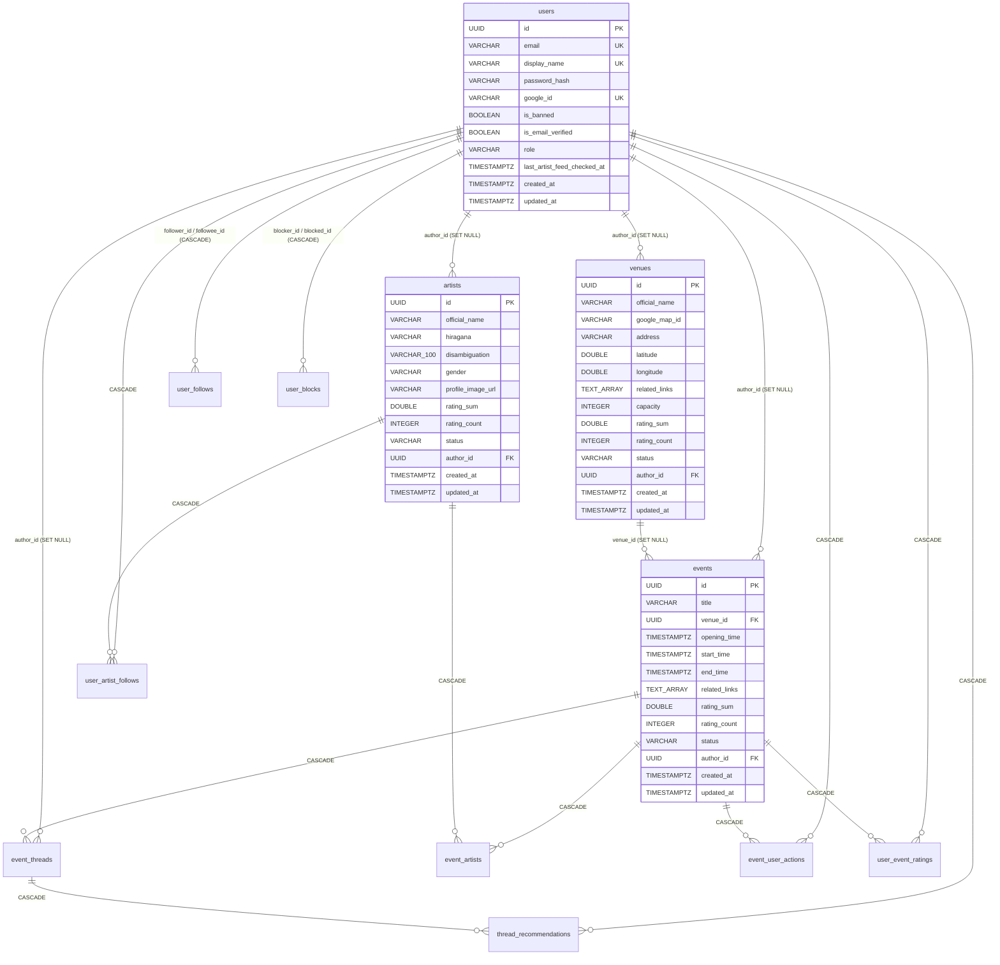

# 🗂️ 데이터베이스 테이블 스키마 명세 및 활용 현황 분석

[⬅️ 홈으로 돌아가기](./Home.md) | [관련 문서: DB 마이그레이션 가이드](./DATABASE_MIGRATION_GUIDE.md) | [관련 문서: sqlc 가이드](./SQLC_GUIDE.md)

이 문서는 `backend/db/migration/`(`000001` ~ `000016`)과 `backend/db/query/*.sql`을 기반으로 Eventer Map의 **PostgreSQL 전체 테이블 스키마(13개 테이블)**를 정의하고, 정리된 요소 및 잔여 검토 항목을 정리한 기술 위키입니다.

---

## 1. 📐 전체 ERD (Entity-Relationship Diagram)

---

## 2. 🗃️ 도메인별 테이블 상세 명세 (총 13개 테이블)

### 2.1. 회원 및 인증 도메인 (`users`, `verification_tokens`)

#### 1) `users` — 사용자 계정
| 컬럼명 | 데이터 타입 | 제약 조건 | 기본값 | 설명 |
| :--- | :--- | :--- | :--- | :--- |
| `id` | `UUID` | `PRIMARY KEY` | `uuid_generate_v4()` | 사용자 고유 식별자 |
| `email` | `VARCHAR` | `UNIQUE`, `NULL` | - | 이메일 주소 |
| `display_name` | `VARCHAR` | `NOT NULL`, `UNIQUE` (`000002`) | - | 사용자 닉네임 |
| `password_hash` | `VARCHAR` | `NULL` | - | bcrypt 해시 비밀번호 (구글 전용 가입 시 `NULL`) |
| `google_id` | `VARCHAR` | `UNIQUE`, `NULL` | - | Google OAuth `sub` 식별자 |
| `is_banned` | `BOOLEAN` | `NOT NULL` | `false` | 계정 정지(Ban) 여부 |
| `is_email_verified` | `BOOLEAN` | `NOT NULL` (`000003`) | `false` | 이메일 인증 완료 여부 |
| `last_artist_feed_checked_at` | `TIMESTAMPTZ` | `NOT NULL` (`000006`) | `'1970-01-01 00:00:00+00'` | 팔로우 아티스트 피드 마지막 확인 시각 (`CountUnreadFollowingArtistEvents`를 통한 미확인 신규 이벤트 수 집계 및 `UpdateLastArtistFeedCheckedAt` 읽음 처리에 사용) |
| `role` | `VARCHAR` | `NOT NULL` (`000008`) | `'USER'` | 권한 (`USER`, `ADMIN`) |
| `created_at` | `TIMESTAMPTZ` | `NOT NULL` | `NOW()` | 가입 시각 |
| `updated_at` | `TIMESTAMPTZ` | `NOT NULL` | `NOW()` | 프로필/비밀번호 수정 시각 |

#### 2) `verification_tokens` — 이메일 회원가입 인증 코드 (`000003`)
| 컬럼명 | 데이터 타입 | 제약 조건 | 기본값 | 설명 |
| :--- | :--- | :--- | :--- | :--- |
| `email` | `VARCHAR` | `PRIMARY KEY` | - | 인증 대상 이메일 |
| `code` | `VARCHAR(6)` | `NOT NULL` | - | 6자리 인증 번호 |
| `expires_at` | `TIMESTAMPTZ` | `NOT NULL` | - | 만료 시각 (발급 후 5분) |

---

### 2.2. 핵심 도메인 (`artists`, `venues`, `events`, `event_artists`)

#### 3) `artists` — 출연자(아티스트) 정보
> `000013`~`000015`를 통해 `birth_date`, `debut_date`, `credit_score`, `credit_count`가 제거되고 `disambiguation` 및 이벤트 평균 평점 캐시(`rating_sum`, `rating_count`)로 일원화되었습니다.

| 컬럼명 | 데이터 타입 | 제약 조건 | 기본값 | 설명 |
| :--- | :--- | :--- | :--- | :--- |
| `id` | `UUID` | `PRIMARY KEY` | `uuid_generate_v4()` | 아티스트 고유 식별자 |
| `official_name` | `VARCHAR` | `NOT NULL` | - | 공식 표기명 |
| `hiragana` | `VARCHAR` | `NULL` | - | 히라가나 읽는 법 (자동완성 검색 지원) |
| `disambiguation` | `VARCHAR(100)` | `NULL` (`000014`) | - | 동명이인 구분용 한 줄 설명 (소속, 분야 등) |
| `gender` | `VARCHAR` | `NOT NULL`, `CHECK IN ('MALE', 'FEMALE')` (`000013`) | - | 성별 (`MALE`, `FEMALE`) |
| `profile_image_url` | `VARCHAR` | `NULL` | - | S3 프로필 이미지 URL |
| `rating_sum` | `DOUBLE PRECISION` | `NOT NULL` | `0` | 참가 이벤트 평균 평점의 합계 (이벤트 평점/수정 시 동기화) |
| `rating_count` | `INTEGER` | `NOT NULL` | `0` | 평점이 매겨진 참가 이벤트 수 (이벤트 평점/수정 시 동기화) |
| `status` | `VARCHAR` | `NOT NULL` | `'PENDING'` | 승인 상태 (`PENDING`, `APPROVED`, `REJECTED`) |
| `author_id` | `UUID` | `FK -> users(id) ON DELETE SET NULL` | - | 최초 등록자 ID |
| `created_at` | `TIMESTAMPTZ` | `NOT NULL` | `NOW()` | 생성 시각 |
| `updated_at` | `TIMESTAMPTZ` | `NOT NULL` | `NOW()` | 수정 시각 |

**활성 인덱스**:
- `idx_artists_lower_name_pattern`: `ON artists (LOWER(official_name) varchar_pattern_ops)`
- `idx_artists_hiragana_pattern`: `ON artists (hiragana varchar_pattern_ops)`

#### 4) `venues` — 공연장(회장) 정보
| 컬럼명 | 데이터 타입 | 제약 조건 | 기본값 | 설명 |
| :--- | :--- | :--- | :--- | :--- |
| `id` | `UUID` | `PRIMARY KEY` | `uuid_generate_v4()` | 공연장 고유 식별자 |
| `official_name` | `VARCHAR` | `NOT NULL` | - | 공연장 공식 이름 |
| `google_map_id` | `VARCHAR` | `NOT NULL` | - | Google Maps Place ID (빈 문자열 허용) |
| `address` | `VARCHAR` | `NOT NULL` | - | 공연장 주소 |
| `latitude` | `DOUBLE PRECISION` | `NOT NULL` | - | 위도 (`-90` ~ `90`) |
| `longitude` | `DOUBLE PRECISION` | `NOT NULL` | - | 경도 (`-180` ~ `180`) |
| `related_links` | `TEXT[]` | `NULL` | - | 관련 웹사이트 URL 배열 |
| `capacity` | `INTEGER` | `NULL` | - | 수용 인원 |
| `rating_sum` | `DOUBLE PRECISION` | `NOT NULL` | `0` | 개최 이벤트 평균 평점의 합계 (이벤트 평점/수정 시 동기화) |
| `rating_count` | `INTEGER` | `NOT NULL` | `0` | 평점이 매겨진 개최 이벤트 수 (이벤트 평점/수정 시 동기화) |
| `status` | `VARCHAR` | `NOT NULL` | `'PENDING'` | 승인 상태 (`PENDING`, `APPROVED`, `REJECTED`) |
| `author_id` | `UUID` | `FK -> users(id) ON DELETE SET NULL` | - | 최초 등록자 ID |
| `created_at` | `TIMESTAMPTZ` | `NOT NULL` | `NOW()` | 생성 시각 |
| `updated_at` | `TIMESTAMPTZ` | `NOT NULL` | `NOW()` | 수정 시각 |

**활성 인덱스**:
- `idx_venues_location`: `ON venues (latitude, longitude)`
- `idx_venues_lower_name_pattern`: `ON venues (LOWER(official_name) varchar_pattern_ops)`

#### 5) `events` — 이벤트(공연/행사) 정보
> `000015`에서 미사용 `poster_image_url` 컬럼이 제거되었습니다.

| 컬럼명 | 데이터 타입 | 제약 조건 | 기본값 | 설명 |
| :--- | :--- | :--- | :--- | :--- |
| `id` | `UUID` | `PRIMARY KEY` | `uuid_generate_v4()` | 이벤트 고유 식별자 |
| `title` | `VARCHAR` | `NOT NULL` | - | 이벤트 제목 |
| `venue_id` | `UUID` | `FK -> venues(id) ON DELETE SET NULL` | - | 개최 공연장 ID |
| `opening_time` | `TIMESTAMPTZ` | `NULL` | - | 개장(Open) 시각 |
| `start_time` | `TIMESTAMPTZ` | `NOT NULL` | - | 시작(Start) 시각 |
| `end_time` | `TIMESTAMPTZ` | `NOT NULL` | - | 종료(End) 시각 |
| `related_links` | `TEXT[]` | `NULL` | - | 예매/공식 안내 링크 배열 |
| `rating_sum` | `DOUBLE PRECISION` | `NOT NULL` | `0` | 참가자 평점(`1`~`5`) 총합 |
| `rating_count` | `INTEGER` | `NOT NULL` | `0` | 평점 참여 인원 수 |
| `status` | `VARCHAR` | `NOT NULL` | `'PENDING'` | 승인 상태 (`PENDING`, `APPROVED`, `REJECTED`) |
| `author_id` | `UUID` | `FK -> users(id) ON DELETE SET NULL` | - | 최초 등록자 ID |
| `created_at` | `TIMESTAMPTZ` | `NOT NULL` | `NOW()` | 생성 시각 |
| `updated_at` | `TIMESTAMPTZ` | `NOT NULL` | `NOW()` | 수정 시각 |

**활성 인덱스**:
- `idx_events_start_time`: `ON events (start_time)`
- `idx_events_time_venue`: `ON events (venue_id, start_time, end_time)`

#### 6) `event_artists` — 이벤트-출연자 N:M 매핑
| 컬럼명 | 데이터 타입 | 제약 조건 | 설명 |
| :--- | :--- | :--- | :--- |
| `event_id` | `UUID` | `PK (1)`, `FK -> events(id) ON DELETE CASCADE` | 이벤트 ID |
| `artist_id` | `UUID` | `PK (2)`, `FK -> artists(id) ON DELETE CASCADE` | 아티스트 ID |

**활성 인덱스**:
- `idx_event_artists_artist_id`: `ON event_artists (artist_id)`

---

### 2.3. 참여·평점·소셜·스레드·시스템 도메인

#### 7) `event_threads` — 이벤트 하위 스레드(커뮤니티/댓글)
이벤트별 상세 정보, 팁, 후기 등 유저들이 자유롭게 작성하는 하위 커뮤니티 스레드입니다.

| 컬럼명 | 데이터 타입 | 제약 조건 | 기본값 | 설명 |
| :--- | :--- | :--- | :--- | :--- |
| `id` | `UUID` | `PK` | `uuid_generate_v4()` | 스레드 고유 식별자 |
| `event_id` | `UUID` | `NOT NULL`, `FK -> events(id) ON DELETE CASCADE` | - | 소속 이벤트 ID |
| `author_id` | `UUID` | `FK -> users(id) ON DELETE SET NULL` | - | 작성자 ID (회원 탈퇴 시 보존) |
| `content` | `TEXT` | `NOT NULL`, `CHECK (char_length(content) BETWEEN 1 AND 1000)` | - | 스레드 본문 (1~1,000자) |
| `recommend_count` | `INTEGER` | `NOT NULL`, `CHECK (recommend_count >= 0)` | `0` | 누적 추천 수 |
| `created_at` | `TIMESTAMPTZ` | `NOT NULL` | `NOW()` | 작성 시각 |
| `updated_at` | `TIMESTAMPTZ` | `NOT NULL` | `NOW()` | 수정 시각 |

**활성 인덱스**:
- `idx_event_threads_event_ranking`: `ON event_threads (event_id, recommend_count DESC, created_at DESC, id DESC)` (추천순 정렬 및 복합 커서 페이지네이션 전용 인덱스)
- `idx_event_threads_author_id`: `ON event_threads (author_id)` (작성자 탈퇴 시 SET NULL 처리 가속)

#### 8) `thread_recommendations` — 스레드 유저 추천 매핑
유저당 스레드 1회 추천을 보장하는 N:M 매핑 테이블입니다.

| 컬럼명 | 데이터 타입 | 제약 조건 | 기본값 | 설명 |
| :--- | :--- | :--- | :--- | :--- |
| `user_id` | `UUID` | `PK (1)`, `FK -> users(id) ON DELETE CASCADE` | - | 추천한 유저 ID |
| `thread_id` | `UUID` | `PK (2)`, `FK -> event_threads(id) ON DELETE CASCADE` | - | 추천 대상 스레드 ID |
| `created_at` | `TIMESTAMPTZ` | `NOT NULL` | `NOW()` | 추천 시각 |

**활성 인덱스**:
- `idx_thread_recommendations_thread_id`: `ON thread_recommendations (thread_id)` (스레드 삭제 시 CASCADE 처리 가속)

#### 9) 기타 상호작용 및 시스템 테이블
- **`event_user_actions`**: `user_id (UUID PK, FK)`, `event_id (UUID PK, FK)`, `status (INT: 1=체크, 2=참가)` — Partial Index `idx_event_user_actions_event_attendees ON event_user_actions (event_id) WHERE status = 2`
- **`user_event_ratings`**: `user_id (UUID PK, FK)`, `event_id (UUID PK, FK)`, `score (INT CHECK 1..5)`
- **`user_follows`**: `follower_id (UUID PK, FK)`, `followee_id (UUID PK, FK)`, `created_at (TIMESTAMPTZ)`
- **`user_blocks`**: `blocker_id (UUID PK, FK)`, `blocked_id (UUID PK, FK)`, `created_at (TIMESTAMPTZ)`
- **`user_artist_follows`**: `user_id (UUID PK, FK)`, `artist_id (UUID PK, FK)`, `created_at (TIMESTAMPTZ)`
- **`daily_visits`**: `visit_date (DATE PK)`, `visit_count (INT)`

---

## 3. 🧹 `000015` 스키마 클린업 완료 내역

1. **삭제된 테이블 (4개)**:
   - `history_reports`, `event_histories` (위키 수정 이력 및 신고 기능 제거)
   - `user_artist_ratings`, `user_venue_ratings` (아티스트/공연장 자체 신용평가 제거)
2. **삭제된 컬럼 (5개)**:
   - `events.poster_image_url`
   - `artists.credit_score`, `artists.credit_count`
   - `venues.credit_score`, `venues.credit_count`
3. **일원화된 평점 아키텍처**:
   - 아티스트와 공연장의 `rating_sum`, `rating_count`는 오직 **참가/개최한 이벤트들의 평균 평점 합계 및 이벤트 수**로만 산출됩니다.
   - 이벤트 평점 등록(`RateEvent`) 및 이벤트 수정(`UpdateEvent`) 트랜잭션 시점에 `RecalculateVenueRatingFromEvents`, `RecalculateArtistRatingFromEvents`, `RecalculateEventArtistsRatingFromEvents`로 즉시 갱신되며, 모든 조회 쿼리(`GetArtist`, `ListArtists`, `GetArtistsForEvent`, `ListFollowingArtists`, `GetVenue`, `ListVenuesByBoundingBox`, `SearchVenues`, `ListEvents`)는 서브쿼리 없이 캐시된 컬럼을 직접 읽도록 최적화되었습니다.
4. **삭제된 중복 인덱스 (3개)**:
   - `idx_artists_name_pattern` (`idx_artists_lower_name_pattern`으로 대체됨)
   - `idx_venues_name_pattern` (`idx_venues_lower_name_pattern`으로 대체됨)
   - `idx_events_venue_id` (`idx_events_time_venue` 복합 인덱스의 선두 컬럼으로 대체됨)

---

## 4. 🚀 `000016` 이벤트 스레드(커뮤니티) 스키마 보강 내역

1. **추천순 복합 커서 인덱스 적용 (`idx_event_threads_event_ranking`)**:
   - 기존의 단순 `(event_id, recommend_count DESC)` 인덱스를 삭제하고, `(event_id, recommend_count DESC, created_at DESC, id DESC)` 복합 B-Tree 인덱스를 생성했습니다.
   - 이를 통해 추천수 동점 상황에서도 `(t.recommend_count, t.created_at, t.id) < (...)` 튜플 비교 쿼리가 인덱스 스캔만으로 고속 처리됩니다.
2. **외래키 인덱스 보강**:
   - `idx_event_threads_author_id`: 유저 탈퇴 시 `ON DELETE SET NULL` 동작 가속.
   - `idx_thread_recommendations_thread_id`: `thread_recommendations`의 복합 PK가 `(user_id, thread_id)` 순서이므로, 스레드 삭제 시 `thread_id` 기준 CASCADE 삭제가 테이블 풀스캔 없이 즉시 처리되도록 인덱스를 추가했습니다.
3. **데이터 무결성 제약조건 추가**:
   - `chk_event_threads_content_length`: 본문 길이 1~1,000자 제한.
   - `chk_event_threads_recommend_count_non_negative`: 추천수 음수 방지(`recommend_count >= 0`).
   - `thread_recommendations.created_at`: 추천 발생 시각 타임스탬프 컬럼 추가.
