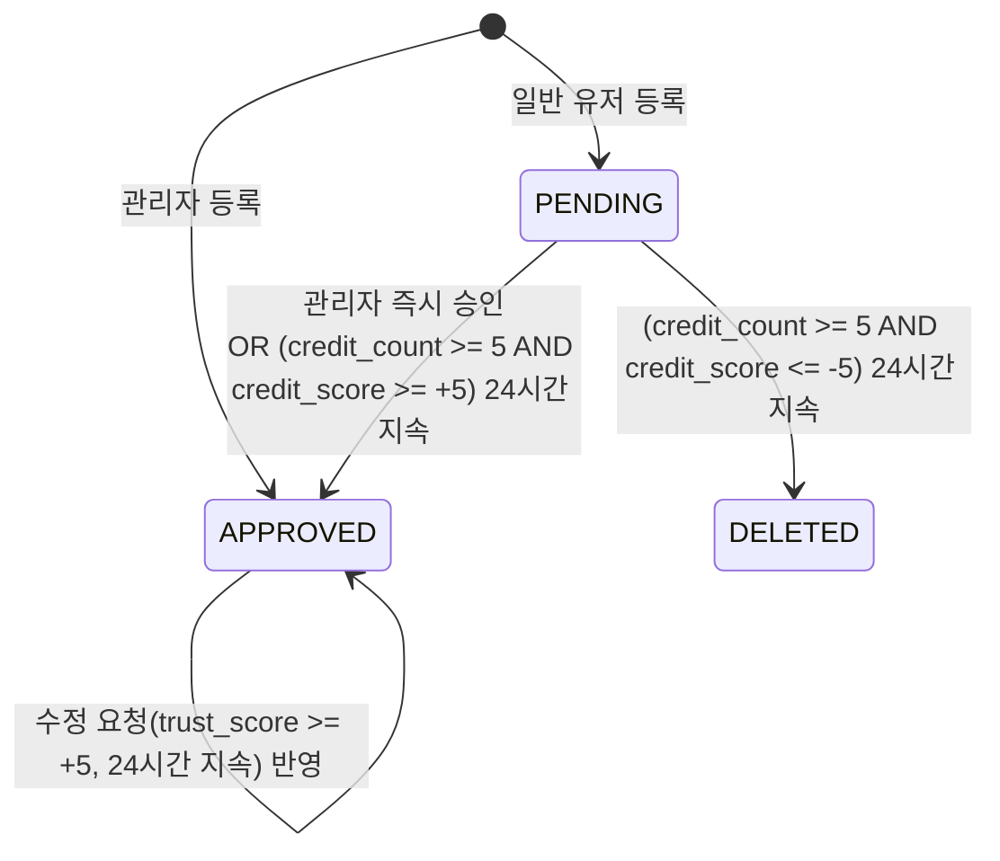

# 🛡️ 데이터 관리 정책 및 신용 점수 · 수정 요청 시스템

[⬅️ 홈으로 돌아가기](./Home.md) | [관련 문서: API 상세 설계서](./API_SPECIFICATION.md) | [관련 문서: DB 스키마](./DATABASE_SCHEMA.md)

본 문서는 Eventer Map의 **유저 데이터(`PENDING`)와 공인 데이터(`APPROVED`) 이원화 정책**, **신용 점수 기반 자동 승격/삭제**, 그리고 **공인 데이터 수정 요청 및 신뢰 점수 시스템**의 설계와 구현을 정리한 문서입니다.

---

## 1. 📋 데이터 분류 및 권한 매트릭스

모든 핵심 도메인 엔티티(**이벤트 `events` · 아티스트 `artists` · 공연장 `venues`**)는 작성자 역할에 따라 초기 상태가 결정됩니다.

- **유저 데이터 (`status = 'PENDING'`)**: 일반 유저(`role = 'USER'`)가 등록한 데이터
- **공인 데이터 (`status = 'APPROVED'`)**: 관리자(`role = 'ADMIN'`)가 등록하거나, 관리자 승인 또는 높은 신용 점수 유지로 승격된 데이터

| 작업 | 유저 데이터 (`PENDING`) | 공인 데이터 (`APPROVED`) | 비고 |
| :--- | :---: | :---: | :--- |
| **직접 수정 (`PUT`)** | 작성자 본인 · 관리자 | **관리자만 가능** | 일반 유저가 공인 데이터를 수정하려면 **수정 요청** 사용 |
| **직접 삭제 (`DELETE`)** | 작성자 본인 · 관리자 | **관리자만 가능** | 아티스트/공연장은 이벤트 참조 중일 때 `409 Conflict` |
| **관리자 즉시 승격 (`POST .../approve`)** | 관리자 전용 | - | `PENDING → APPROVED` 즉시 전환 |
| **신용 점수 투표 (`PUT .../credit`)** | 작성자 제외 모든 활성 유저 | 작성자 제외 모든 활성 유저 | `+1` / `-1` / `0`(취소) |
| **수정 요청 (`POST /modification-requests`)** | 불가 (직접 수정 이용) | **모든 활성 유저 가능** | `APPROVED` 엔티티에 대해서만 허용 |

> [!NOTE]
> 정지된 계정(`is_banned = true`)은 데이터 등록, 수정, 삭제, 신용/신뢰 투표, 수정 요청 등록이 모두 차단(`403 Forbidden`)됩니다.

---

## 2. ⭐ 신용 점수 기반 자동 승격 / 자동 삭제

### 2.1. 상태 전이 흐름

### 2.2. 판정 기준 및 동작 규칙 (`backend/internal/service/credit_service.go`)
- **투표 방식**: 인증된 유저가 대상 엔티티에 `+1`(신뢰), `-1`(불신), `0`(투표 취소)을 1인 1표로 행사합니다. (작성자 본인은 투표 불가)
- **지속 임계 상수**:
  - `MinCreditVotes = 5` (최소 참여 투표 수)
  - `PromoteScoreThreshold = 5` (순점수 `+5` 이상)
  - `DeleteScoreThreshold = -5` (순점수 `-5` 이하)
  - `SustainedCreditDuration = 24 * time.Hour` (유지 기간)
- **타임스탬프 추적**:
  - `PENDING` 엔티티가 `credit_count >= 5 && credit_score >= +5`에 도달하면 `high_credit_since`에 최초 도달 시각이 기록됩니다. 중간에 점수가 내려가면 `NULL`로 초기화됩니다.
  - `PENDING` 엔티티가 `credit_count >= 5 && credit_score <= -5`에 도달하면 `low_credit_since`에 최초 도달 시각이 기록됩니다. 중간에 점수가 올라가면 `NULL`로 초기화됩니다.
  - **24시간 경과 후**:
    - `high_credit_since <= NOW() - 24h`이면 `status = 'APPROVED'`로 자동 승격됩니다.
    - `low_credit_since <= NOW() - 24h`이면 해당 `PENDING` 레코드가 자동 삭제됩니다.
    - 이미 `APPROVED` 된 공인 데이터는 신용 점수가 낮아져도 자동 삭제되지 않습니다.

---

## 3. ✏️ 공인 데이터 수정 요청 및 신뢰 점수 시스템

공인(`APPROVED`) 데이터는 일반 유저가 직접 수정할 수 없는 대신, **수정 요청(`modification_requests`)**을 통해 변경을 제안하고 커뮤니티의 신뢰 점수로 반영 여부를 결정합니다.

### 3.1. 동작 규칙
1. **요청 등록 (`POST /modification-requests`)**:
   - 대상 엔티티(`EVENT`, `ARTIST`, `VENUE`)가 `APPROVED` 상태일 때만 등록 가능합니다.
   - 변경할 필드(`proposedData` JSONB)와 사유(`reason`)를 함께 제출합니다.
2. **신뢰 점수 투표 (`PUT /modification-requests/{requestId}/trust`)**:
   - 작성자 본인을 제외한 모든 활성 유저가 `+1` / `-1` / `0`(취소)으로 투표합니다.
   - `MinTrustVotes = 5`, `ApplyTrustThreshold = 5`, `RejectTrustThreshold = -5`, `SustainedTrustDuration = 24 * time.Hour` 기준으로 `high_trust_since` / `low_trust_since`가 기록됩니다.
3. **자동 반영 및 삭제**:
   - `high_trust_since`가 **24시간** 유지되면 단일 트랜잭션 내에서 대상 엔티티의 필드를 `proposedData`로 업데이트하고, 요청 상태를 `APPLIED`(`resolved_at = NOW()`)로 전환합니다.
   - `low_trust_since`가 **24시간** 유지되면 해당 `PENDING` 수정 요청은 자동 삭제됩니다.
4. **직접 삭제 및 관리자 즉시 반영**:
   - 작성자 본인(단, `PENDING` 상태일 때) 또는 관리자는 `DELETE /modification-requests/{requestId}`로 요청을 삭제할 수 있습니다.
   - 관리자는 `POST /modification-requests/{requestId}/apply`로 대기 없이 즉시 반영할 수 있습니다.

---

## 4. ⚡ 서버리스(AWS Lambda) 대응 지연 평가 (Lazy Evaluation)

Eventer Map 백엔드는 로컬 `net/http` 서버와 **AWS Lambda** 서버리스 환경에서 동일하게 실행되므로, 상주 백그라운드 고루틴에 의존하지 않습니다.

- `CreditService.MaybeProcessSustainedLifecycle(ctx)`가 `atomic.Int64` 기반 **30초 스로틀링(`lifecycleCheckInterval`)**으로 동작합니다.
- 엔티티 목록/상세 조회, 신용 투표, 수정 요청 목록/투표 API 호출 시 30초 간격으로 `ProcessSustainedLifecycle(ctx)`를 실행하여 24시간 지속 조건이 충족된 승격·삭제·수정 반영을 즉시 처리합니다.

---

## 5. 🧩 구현 위치 요약

- **DB 마이그레이션**: `backend/db/migration/000021_add_credit_scores_and_modification_requests.{up,down}.sql`
- **SQL 쿼리 & Repository**:
  - `backend/db/query/credit.sql`, `backend/db/query/modification_request.sql`
  - `backend/internal/repository/credit.sql.go`, `backend/internal/repository/modification_request.sql.go`
- **Service & Handler**:
  - `backend/internal/service/credit_service.go`, `event_service.go`, `artist_service.go`, `venue_service.go`
  - `backend/internal/handler/credit_handler.go`, `event_handler.go`, `artist_handler.go`, `venue_handler.go`
- **Frontend UI & 다국어**:
  - `frontend/src/components/common/CreditVoteSection.tsx`
  - `frontend/src/components/common/ModificationRequestsSection.tsx`
  - `frontend/src/components/events/EventDetailPane.tsx`, `EntityInfoCard.tsx`
  - `frontend/src/i18n/locales/{ko,en,ja,zh}.json` (`credit`, `modRequest`, `common`, `event`, `artist`, `venue` 섹션)
