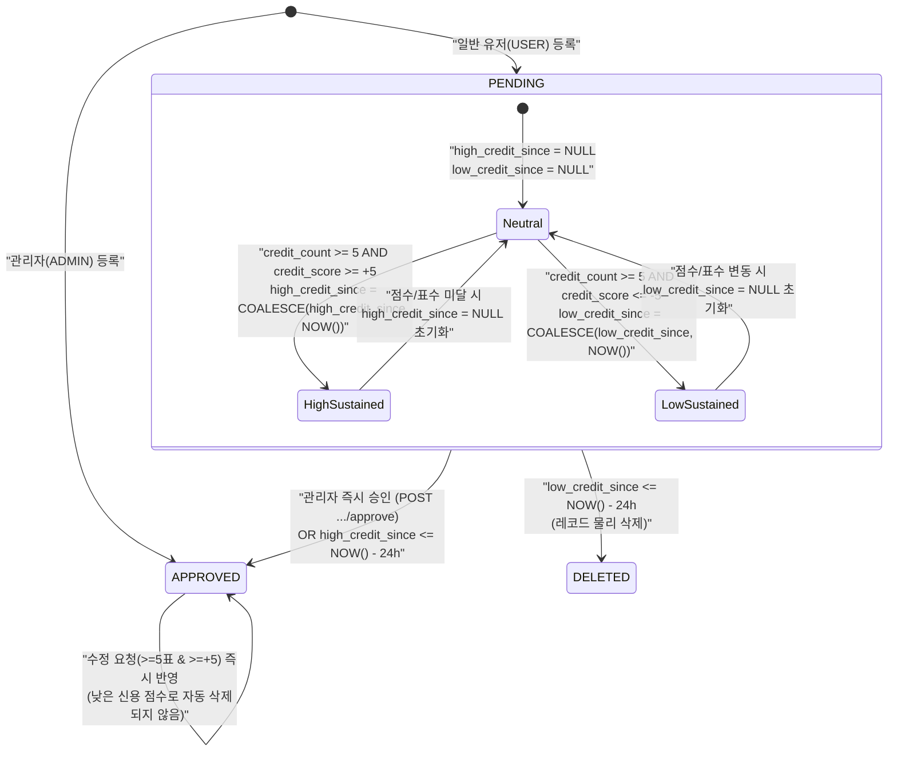
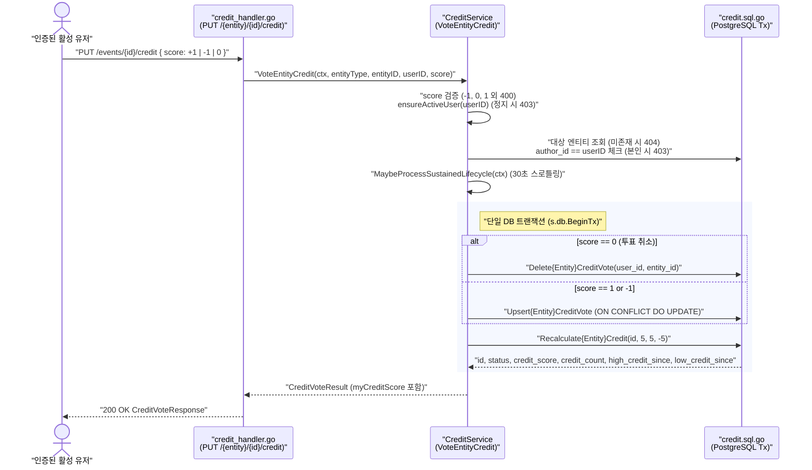
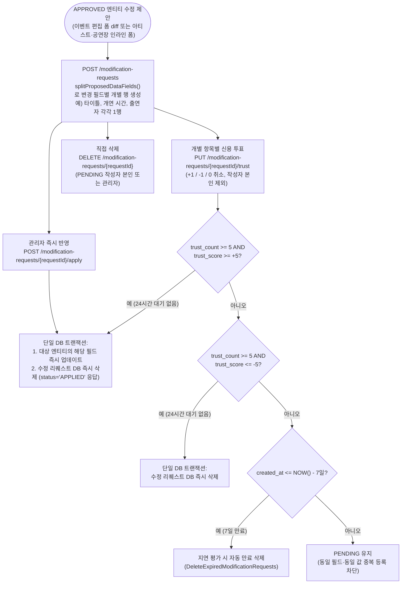
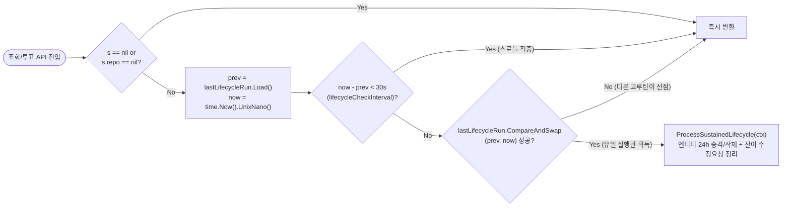

# 🛡️ 데이터 신뢰도 시스템 (거버넌스 정책 · 신용 점수 · 수정 요청)

[⬅️ 홈으로 돌아가기](./Home.md) | [관련 문서: 시스템 아키텍처](./ARCHITECTURE.md) | [관련 문서: API 상세 설계서](./API_SPECIFICATION.md) | [관련 문서: DB 스키마](./DATABASE_SCHEMA.md)

본 문서는 Eventer Map의 **이원화 데이터 거버넌스(`PENDING` vs `APPROVED`)**, **커뮤니티 신용 점수(Credit Score) 기반 자동 승격·삭제**, **필드별 개별 공인 데이터 수정 리퀘스트 및 즉시 반영·삭제 시스템**, 그리고 **AWS Lambda 서버리스 환경 대응 지연 평가(Lazy Evaluation) 아키텍처**의 설계와 실제 구현을 정리한 기술 문서입니다.

---

## 1. 🧭 개요 및 설계 철학 (Overview & Architecture Philosophy)

Eventer Map은 사용자가 공연장·아티스트·이벤트 정보를 자유롭게 등록하고 보완하는 **위키형 크라우드소싱 플랫폼**입니다. 동시에 허위·중복 정보나 공인 데이터 훼손(반달리즘)을 방지하기 위해 **2계층 커뮤니티 검증 + 관리자 거버넌스** 모델을 채택합니다.

1. **1계층 — 신규 엔티티 신용 점수 검증 (`Credit Score`)**:
   - 일반 유저가 등록한 데이터는 즉시 서비스에 노출되되 **`PENDING` (유저 데이터)** 상태로 시작합니다.
   - 커뮤니티의 `+1` / `-1` 투표(`MinCreditVotes = 5` 이상)를 통해 **순점수 `+5` 이상을 24시간 유지하면 `APPROVED`(공인 데이터)로 자동 승격**되고, **순점수 `-5` 이하를 24시간 유지하면 자동 삭제**됩니다.
2. **2계층 — 공인 데이터 필드별 수정 리퀘스트 및 즉시 반영 (`Field-Level Modification Request & Trust Score`)**:
   - `APPROVED` 상태가 된 공인 데이터는 작성자 본인을 포함한 일반 유저가 직접 덮어쓸 수 없으며, 수정 폼(`EventFormPane` 등)에서 변경을 저장하면 **변경된 필드별(`타이틀`, `개연 시간`, `출연자` 등)로 개별 수정 리퀘스트가 분리 등록**됩니다.
   - 상세 화면의 기본 정보 바로 아래에 **기본적으로 접힌(`isExpanded = false`)** 상태로 표시되며, 펼쳤을 때 개별 수정 항목마다 커뮤니티가 `+1` / `-1` 신용(신뢰) 점수를 투표합니다.
   - **최소 5표(`MinTrustVotes = 5`) 이상 & 순점수 `+5` 이상에 도달하면 24시간 대기 없이 즉시 실제 데이터에 반영되고 해당 수정 리퀘스트는 삭제**됩니다. 반대로 **최소 5표 이상 & 순점수 `-5` 이하에 도달하면 즉시 삭제**됩니다.

### 1.1. 만족도 평점(`rating`)과 데이터 신뢰도(`credit` / `trust`)의 역할 분리

Eventer Map은 초기 마이그레이션(`000008`~`000009`)에서 아티스트·공연장 자체 평가와 신용 점수를 혼용하던 구조를 정리하고, `000015` 및 `000021` 마이그레이션을 거치며 **서비스 품질/만족도 평가**와 **데이터 진위/신뢰도 검증**을 완전히 분리했습니다.

| 구분 | 만족도 평점 (`rating_sum`, `rating_count`) | 엔티티 신용 점수 (`credit_score`, `credit_count`) | 수정 리퀘스트 신뢰 점수 (`trust_score`, `trust_count`) |
| :--- | :--- | :--- | :--- |
| **목적** | 공연 경험에 대한 주관적 만족도 측정 | 등록된 엔티티 정보의 사실성·유효성 검증 | 공인 엔티티의 **개별 필드** 수정 제안 타당성 검증 |
| **대상** | `events` (아티스트·공연장은 이벤트 평균에서 파생 캐시) | `events`, `artists`, `venues` | `modification_requests` (`APPROVED` 대상 필드별 항목) |
| **참여 자격** | 이벤트 참가자(`event_user_actions.status = 2`) | 작성자 본인 제외한 모든 활성(`!is_banned`) 인증 유저 | 작성자 본인 제외한 모든 활성(`!is_banned`) 인증 유저 |
| **점수 체계** | 1~5점 정수 별점 (`user_event_ratings`) | `+1` / `-1` / `0`(취소) (`*_credit_votes`) | `+1` / `-1` / `0`(취소) (`modification_request_votes`) |
| **상태 영향** | 검색/대표 출연자 정렬 가중치에만 반영 | 24h 지속 조건 충족 시 `APPROVED` 승격 또는 `PENDING` 레코드 삭제 | `>= 5표 & >= +5` 도달 즉시 엔티티 반영 후 리퀘스트 삭제 (`<= -5` 도달 시 즉시 삭제) |

---

## 2. 📋 이원화 데이터 상태 모델 및 권한 매트릭스

### 2.1. 초기 상태 결정 (`CreateEvent` · `CreateArtist` · `CreateVenue`)

엔티티 생성 시 백엔드 서비스 계층(`event_service.go`, `artist_service.go`, `venue_service.go`)은 `users` 테이블에서 작성자 정보를 조회해 다음 순서로 초기 상태를 결정합니다.

1. `user.IsBanned == true` 인 경우 `ErrUserBanned`를 반환해 등록을 차단합니다(`403 Forbidden`, 단 `PostEvents`는 명시적 `403`, `PostArtists`/`PostVenues`는 현재 서비스 에러 전파 경로를 따름).
2. `user.Role == "ADMIN"` 인 경우 초기 `status = 'APPROVED'`로 즉시 공인 데이터로 생성합니다.
3. 일반 유저(`user.Role == "USER"`)인 경우 초기 `status = 'PENDING'`으로 생성합니다.

> [!NOTE]
> `events`, `artists`, `venues`의 `author_id` 외래키는 모두 **`ON DELETE SET NULL`**로 정의되어 있어, 최초 등록자가 회원 탈퇴하더라도 엔티티 데이터는 보존됩니다. 또한 `author_id`가 `NULL`인 경우 작성자 본인 식별이 불가능하므로 `PENDING` 상태에서의 직접 수정·삭제 권한은 관리자에게만 남고, 모든 활성 유저가 신용 점수에 투표할 수 있습니다.

### 2.2. 상태별 작업 권한 및 조회 규칙 매트릭스

| 작업 | 유저 데이터 (`status = 'PENDING'`) | 공인 데이터 (`status = 'APPROVED'`) | 구현 근거 및 예외 사항 |
| :--- | :--- | :--- | :--- |
| **상세/목록 조회 (`GET`)** | 누구나 조회 가능 (UI에 `승인 대기` 배지 표시) | 누구나 조회 가능 | `EntityStatusBadge`는 `status !== 'APPROVED'`일 때만 표시 |
| **자동완성 우선 정렬** | 후순위 정렬 (`1`) | **우선 정렬 (`0`)** | `ListArtists`, `SearchVenues`의 `ORDER BY CASE WHEN status = 'APPROVED' THEN 0 ELSE 1 END, official_name ASC` (`REJECTED` 제외) |
| **직접 수정 (`PUT`)** | **작성자 본인 또는 관리자** | **관리자만 가능** (`403 Forbidden`) | 일반 유저가 공인 이벤트 수정 폼 저장 시 자동으로 `POST /modification-requests`로 우회 등록 |
| **직접 삭제 (`DELETE`)** | **작성자 본인 또는 관리자** | **관리자만 가능** (`403 Forbidden`) | 아티스트(`CheckArtistInEvent`)·공연장(`CheckVenueInEvent`)이 이벤트에서 참조 중이면 **`409 Conflict` (`ErrEntityInUse`)** 반환 |
| **관리자 즉시 승격 (`POST .../approve`)** | 관리자 전용 (`APPROVED` 전환 + `high/low_credit_since = NULL` 초기화) | - (`ADMIN`만 `403` 없이 통과) | `ApproveEvent`, `ApproveArtist`, `ApproveVenue` |
| **신용 점수 투표 (`PUT .../credit`)** | 작성자 제외 모든 활성 유저 | 작성자 제외 모든 활성 유저 | `APPROVED` 상태는 점수가 낮아져도 `low_credit_since`가 기록되지 않아 자동 삭제 대상에서 제외 |
| **수정 리퀘스트 등록 (`POST /modification-requests`)** | **불가** (`400 Bad Request`, `ErrEntityNotOfficial`) | **모든 활성 유저 가능** | `APPROVED` 상태 엔티티에 대해서만 허용, **변경된 필드별로 개별 항목 분리 저장** |

> [!IMPORTANT]
> 정지된 계정(`users.is_banned = true`)은 `CreditService.ensureActiveUser()` 및 각 도메인 서비스의 `IsBanned` 검증에 의해 등록, 수정, 삭제, 신용 투표, 수정 요청 등록, 신뢰 투표, 관리자 승인/반영이 모두 `403 Forbidden`으로 차단됩니다.

---

## 3. ⭐ 엔티티 신용 점수 시스템 (`Credit Score System`)

### 3.1. 상태 전이 및 생명주기

### 3.2. 판정 임계 상수 (`backend/internal/service/credit_service.go`)

| 상수명 | 값 | 설명 |
| :--- | :---: | :--- |
| `MinCreditVotes` | `5` | 승격·삭제 지속 타이머가 작동하기 위한 최소 누적 투표 수 (`credit_count`) |
| `PromoteScoreThreshold` | `+5` | 자동 승격 타이머(`high_credit_since`) 진입 기준 순점수 (`credit_score >= 5`) |
| `DeleteScoreThreshold` | `-5` | 자동 삭제 타이머(`low_credit_since`) 진입 기준 순점수 (`credit_score <= -5`) |
| `SustainedCreditDuration` | `24 * time.Hour` | 승격 또는 삭제가 확정되기까지 점수가 유지되어야 하는 최소 시간 |

### 3.3. 1인 1표 투표 처리 및 지속 타이머 재계산 흐름

#### SQL 레벨 원자적 재계산 (`backend/db/query/credit.sql`)

`RecalculateEventCredit`, `RecalculateArtistCredit`, `RecalculateVenueCredit` 쿼리는 단일 `UPDATE ... RETURNING` 문으로 다음을 원자적으로 처리합니다.

1. **투표 집계 갱신**:
   - `credit_score = COALESCE((SELECT SUM(score)::int FROM ..._credit_votes ...), 0)`
   - `credit_count = COALESCE((SELECT COUNT(*)::int FROM ..._credit_votes ...), 0)`
2. **지속 타이머 시작 / 유지 / 초기화**:
   - `high_credit_since`: `status = 'PENDING'` 이고 `credit_count >= 5` 이며 `credit_score >= +5`이면 `COALESCE(high_credit_since, NOW())`를 적용해 **최초 도달 시각을 보존**합니다. 조건에서 벗어나거나 `APPROVED` 상태면 `NULL`로 초기화합니다.
   - `low_credit_since`: `status = 'PENDING'` 이고 `credit_count >= 5` 이며 `credit_score <= -5`이면 `COALESCE(low_credit_since, NOW())`를 적용하고, 조건에서 벗어나거나 `APPROVED` 상태면 `NULL`로 초기화합니다.
3. **일시적 스파이크 방어**:
   - 24시간이 지나기 전에 단 1표라도 취소·반대 투표가 발생해 `credit_score < 5` 또는 `credit_count < 5`가 되면 `high_credit_since`가 `NULL`로 리셋됩니다. 이후 다시 조건을 달성하면 새로운 `NOW()`부터 24시간을 다시 카운트합니다.
4. **지속 기간 만료 시 배치 전이**:
   - `PromoteSustained{Events|Artists|Venues}`: `WHERE status = 'PENDING' AND high_credit_since IS NOT NULL AND high_credit_since <= NOW() - 24h` 조건을 만족하는 행을 `status = 'APPROVED'`, `high_credit_since = NULL`, `low_credit_since = NULL`로 승격합니다.
   - `DeleteSustainedLowCredit{Events|Artists|Venues}`: `WHERE status = 'PENDING' AND low_credit_since IS NOT NULL AND low_credit_since <= NOW() - 24h` 조건을 만족하는 행을 물리 삭제(`DELETE`)합니다.

> [!WARNING]
> `DeleteSustainedLowCreditArtists` / `DeleteSustainedLowCreditVenues`의 경우, `artists`는 `event_artists(artist_id)`에 `ON DELETE CASCADE`로 연결되어 있고, `venues`는 `events(venue_id)`에 `ON DELETE SET NULL`로 연결되어 있습니다. 반면 사용자가 직접 호출하는 `DELETE /artists/{id}` 및 `DELETE /venues/{id}`는 `CheckArtistInEvent` / `CheckVenueInEvent` 검사로 이벤트 참조 시 `409 Conflict`를 반환해 실수로 인한 연결 해제를 방지합니다.

---

## 4. ✏️ 공인 데이터 필드별 수정 리퀘스트 및 즉시 반영 시스템

공인(`APPROVED`) 데이터는 일반 유저가 `PUT`으로 직접 덮어쓸 수 없는 대신, **변경된 필드별로 독립된 수정 리퀘스트(`modification_requests`)**를 등록하고 각 항목에 대한 커뮤니티 신용 점수로 즉시 반영 또는 삭제를 결정합니다.

### 4.1. 필드별 분리 생성 및 즉시 반영·삭제 생명주기

| 상수명 | 값 | 설명 |
| :--- | :---: | :--- |
| `MinTrustVotes` | `5` | 수정 리퀘스트 자동 반영·삭제가 발동하기 위한 최소 누적 투표 수 (`trust_count`) |
| `ApplyTrustThreshold` | `+5` | 실제 엔티티 반영 및 리퀘스트 삭제 발동 기준 순점수 (`trust_score >= 5`) |
| `RejectTrustThreshold` | `-5` | 수정 리퀘스트 기각(즉시 삭제) 발동 기준 순점수 (`trust_score <= -5`) |
| `SustainedTrustDuration` | `0` | 24시간 대기 없이 임계치 도달 즉시 반영·삭제 처리 |
| `ModificationRequestTTL` | `7 * 24 * time.Hour` | 미결(`PENDING`) 수정 리퀘스트 자동 만료 삭제 기한 (등록 후 7일) |

### 4.2. 주요 규칙 및 권한 검증

1. **필드별 개별 분리 등록 및 중복 방지 (`CreateModificationRequest`)**:
   - 정지 유저(`is_banned = true`) 차단 (`403 Forbidden`).
   - 대상 엔티티(`EVENT` / `ARTIST` / `VENUE`)의 `status === 'APPROVED'`인지 검증하며, 비공인 상태면 `400 Bad Request` (`ErrEntityNotOfficial`)를 반환합니다.
   - `splitProposedDataFields()`가 입력된 `proposedData`에서 유효한 필드를 추출해 **필드별 독립 맵 슬라이스**로 분리합니다. (예: `title`, `startTime`, `artistIds` 3개 필드가 변경되었으면 3개의 독립 `modification_requests` 행 생성)
   - **동일 필드·동일 값 중복 등록 방지**: 트랜잭션 내에서 만료된 요청(`created_at <= NOW() - 7d`)을 먼저 정리한 뒤 현재 엔티티의 `PENDING` 요청 목록과 정규화 시그니처(`canonicalFieldSignature`: `venueName`/`artistNames` 보조 라벨 제외, `artistIds` 순서 무관 비교)를 대조합니다 (`filterNonDuplicateFieldItems`).
     - 여러 필드 중 일부만 중복이면 **중복 항목은 건너뛰고 새 변경 항목만 등록**합니다.
     - 제출된 모든 필드가 이미 동일한 값으로 `PENDING` 상태에 존재하면 **`409 Conflict` (`code: "DUPLICATE_MODIFICATION_REQUEST"`, `ErrDuplicateModification`)**를 반환해 프론트엔드 다국어 안내 토스트를 표시합니다.
   - `EVENT`의 `venueId` 또는 `artistIds`만 전달되고 `venueName` / `artistNames` 라벨이 없으면 `enrichFieldModificationLabels()`가 DB에서 공식 이름을 조회해 JSONB에 함께 저장합니다.
   - 유효한 변경 필드가 하나도 없으면 `400 Bad Request` (`ErrEmptyModification`)를 반환하며, 모든 행 생성은 단일 DB 트랜잭션으로 원자적 처리됩니다.
2. **개별 항목 신용 점수 투표 및 즉시 반영·삭제 (`VoteModificationRequestTrust`)**:
   - `score`는 `-1`, `0`, `1` 중 하나여야 합니다 (`400 Bad Request`, `ErrInvalidCreditScore`).
   - 요청 작성자 본인은 투표할 수 없습니다 (`403 Forbidden`, `ErrSelfVoteNotAllowed`).
   - 단일 DB 트랜잭션 내에서 투표 Upsert/Delete 및 `RecalculateModificationRequestTrust` 실행 후:
     - `trust_count >= 5 && trust_score >= +5` 도달 즉시 동일 트랜잭션에서 `applyModificationWithQueries()`로 대상 엔티티의 해당 필드를 업데이트하고, `DeleteModificationRequest()`로 리퀘스트를 DB에서 삭제한 뒤 `status: "APPLIED"`를 반환합니다.
     - `trust_count >= 5 && trust_score <= -5` 도달 즉시 동일 트랜잭션에서 `DeleteModificationRequest()`로 기각된 리퀘스트를 DB에서 삭제합니다.
3. **직접 삭제 (`DeleteModificationRequest`)**:
   - `ADMIN`은 상태와 무관하게 삭제 가능.
   - 일반 유저는 `req.Status == "PENDING"`이고 `req.AuthorID == userID`일 때만 삭제 가능 (`403 Forbidden`).
4. **관리자 즉시 반영 (`ApplyModificationRequestByAdmin`)**:
   - `ADMIN` 전용(`403 Forbidden`). 단일 트랜잭션에서 `applyModificationWithQueries()` 실행 후 `DeleteModificationRequest()`로 해당 수정 리퀘스트를 삭제하고 `status: "APPLIED"`를 반환합니다.

### 4.3. 엔티티별 `proposedData` (`JSONB`) 분리 및 반영 매핑 규칙

`splitProposedDataFields()`로 분리되어 저장된 각 필드 항목은 `applyModificationWithQueries()` 내부의 엔티티별 적용 함수에서 `COALESCE` / `sqlc.narg` 기반 부분 업데이트로 처리됩니다.

| 엔티티 타입 | 백엔드 적용 함수 | 분리 단위 (`proposedData` 키) | 타입·검증 및 반영 동작 (`credit_service.go`) |
| :--- | :--- | :--- | :--- |
| **`EVENT`** | `applyEventModification` | `title` | 공백 제외 후 빈 문자열이 아니면 갱신 |
| | | `date` | `"YYYY-MM-DD"` (`UTC+9` 기준). 기존 `StartTime`/`EndTime`/`OpeningTime`의 시각(미지정 `59초` 센티넬 및 익일 종료 오프셋 포함)을 유지한 채 개최 날짜만 변경 |
| | | `openingTime` | `""` 전달 시 `ClearOpeningTime = true` (`NULL`), `"HH:mm"` 또는 RFC3339 문자열이면 현재 이벤트 날짜(`UTC+9`) 기준 **분 단위 절삭** 후 갱신 |
| | | `startTime` | `""` 전달 시 해당일 `00:00:59` 미지정 센티넬 설정, `"HH:mm"` 또는 RFC3339 문자열이면 **분 단위 절삭** 후 갱신 |
| | | `endTime` | `""` 전달 시 해당일 `23:59:59` 미지정 센티넬 설정, `"HH:mm"` 또는 RFC3339 문자열이면 **분 단위 절삭** 후 갱신 (시작 시각보다 이르면 익일 `+24h` 보정) |
| | | `venueId` (+ `venueName`) | 유효한 non-nil UUID면 `venue_id` 변경 후 기존·신규 공연장의 평균 평점 캐시(`RecalculateVenueRatingFromEvents`) 동기화 |
| | | `artistIds` (+ `artistNames`) | `ClearArtistsFromEvent` 후 유효한 UUID들을 `AddArtistToEvent`로 재연결하고 기존·신규 출연자의 평점 캐시(`RecalculateArtistRatingFromEvents`, `RecalculateEventArtistsRatingFromEvents`) 동기화 |
| | | `relatedLinks` | 문자열 배열에서 공백 제거 후 비어 있지 않은 항목으로 교체 |
| **`ARTIST`** | `applyArtistModification` | `officialName` | 공백 제외 후 빈 문자열이 아니면 갱신 |
| | | `hiragana` | 문자열(빈 문자열 포함 트리밍) 전달 시 갱신 |
| | | `disambiguation` | 문자열(빈 문자열 포함 트리밍) 전달 시 갱신 |
| | | `gender` | `"MALE"` 또는 `"FEMALE"`일 때만 갱신 |
| **`VENUE`** | `applyVenueModification` | `officialName` | 공백 제외 후 빈 문자열이 아니면 갱신 |
| | | `address` | 문자열(트리밍) 전달 시 갱신 |
| | | `capacity` | `> 0` 양수일 때 `int32`로 변환해 갱신 |
| | | `latitude` + `longitude` | 좌표 1개 항목으로 묶여 저장·갱신 |
| | | `relatedLinks` | 문자열 배열에서 공백 제거 후 비어 있지 않은 항목으로 교체 |

---

## 5. ⚡ 서버리스(AWS Lambda) 대응 지연 평가 (Lazy Evaluation)

Eventer Map 백엔드는 로컬 `net/http` 서버뿐 아니라 요청 단위로 실행·동결되는 **AWS Lambda** 환경에서 동작하므로, 상시 실행되는 백그라운드 고루틴이나 외부 크론 스케줄러 없이 API 요청 시점에 **신규(`PENDING`) 엔티티의 24시간 지속 신용 점수 상태 전이**를 평가합니다. (수정 리퀘스트는 `SustainedTrustDuration = 0`으로 투표 시점에 즉시 반영·삭제됩니다.)

### 5.1. 30초 스로틀링 & CAS 동시성 제어 (`MaybeProcessSustainedLifecycle`)

- `lastLifecycleRun`은 `atomic.Int64`로 관리되며, `lifecycleCheckInterval = 30 * time.Second` 간격으로 **단 하나의 요청만 `CompareAndSwap`을 통과**해 배치 처리를 수행하므로 동시 요청 폭주 시에도 DB 부하를 방지합니다.
- `ProcessSustainedLifecycle(ctx)`는 다음 9개 작업을 순차 실행합니다 (`creditCutoff = NOW().UTC() - 24h`, `trustCutoff = NOW().UTC()`, `expiredCutoff = NOW().UTC() - 7d`):
  1. `PromoteSustainedEvents(creditCutoff)`
  2. `DeleteSustainedLowCreditEvents(creditCutoff)`
  3. `PromoteSustainedArtists(creditCutoff)`
  4. `DeleteSustainedLowCreditArtists(creditCutoff)`
  5. `PromoteSustainedVenues(creditCutoff)`
  6. `DeleteSustainedLowCreditVenues(creditCutoff)`
  7. `ListSustainedHighTrustModificationRequests(trustCutoff)` 조회 후 잔존 임계 도달 요청 `applyModificationRequest(ctx, req)` 실행 및 삭제
  8. `DeleteSustainedLowTrustModificationRequests(trustCutoff)`
  9. `DeleteExpiredModificationRequests(expiredCutoff)` — 등록 후 7일(`ModificationRequestTTL`)이 지난 미결(`PENDING`) 수정 리퀘스트 자동 만료 삭제

### 5.2. 지연 평가 호출 진입점 (총 8개 경로)

| 계층 | 위치 | 트리거 시점 |
| :--- | :--- | :--- |
| **Handler** | `event_handler.go` ➔ `GetEventsEventId` | `GET /events/{eventId}` 이벤트 상세 조회 시 |
| **Handler** | `artist_handler.go` ➔ `GetArtists` | `GET /artists` 아티스트 목록/자동완성 조회 시 |
| **Handler** | `artist_handler.go` ➔ `GetArtistsArtistId` | `GET /artists/{artistId}` 아티스트 상세 조회 시 |
| **Handler** | `venue_handler.go` ➔ `GetVenuesVenueId` | `GET /venues/{venueId}` 공연장 상세 조회 시 |
| **Service** | `credit_service.go` ➔ `VoteEntityCredit` | `PUT /{events|artists|venues}/{id}/credit` 신용 투표 전 |
| **Service** | `credit_service.go` ➔ `CreateModificationRequest` | `POST /modification-requests` 등록 전 (트랜잭션 내 7일 만료 정리 병행) |
| **Service** | `credit_service.go` ➔ `ListModificationRequests` | `GET /modification-requests` 수정 요청 목록 조회 전 |
| **Service** | `credit_service.go` ➔ `VoteModificationRequestTrust` | `PUT /modification-requests/{requestId}/trust` 신뢰 투표 전 |

---

## 6. 💾 DB 스키마 · 인덱스 및 API 명세 요약

### 6.1. 데이터베이스 구조 (`000021_add_credit_scores_and_modification_requests`)

1. **엔티티 테이블 확장 컬럼 (`events`, `artists`, `venues`)**:
   - `credit_score INTEGER NOT NULL DEFAULT 0`
   - `credit_count INTEGER NOT NULL DEFAULT 0`
   - `high_credit_since TIMESTAMPTZ`
   - `low_credit_since TIMESTAMPTZ`
   - **부분 인덱스(Partial Index)** — `PENDING` 행만 인덱싱하여 24시간 만료 스캔 비용 최소화:
     - `idx_events_pending_credit_lifecycle ON events (high_credit_since, low_credit_since) WHERE status = 'PENDING'`
     - `idx_artists_pending_credit_lifecycle ON artists (high_credit_since, low_credit_since) WHERE status = 'PENDING'`
     - `idx_venues_pending_credit_lifecycle ON venues (high_credit_since, low_credit_since) WHERE status = 'PENDING'`
2. **신용 투표 테이블 (3개)**:
   - `event_credit_votes (user_id, event_id, score CHECK IN (1, -1))` — `PRIMARY KEY (user_id, event_id)`, 둘 다 `ON DELETE CASCADE`
   - `artist_credit_votes (user_id, artist_id, score CHECK IN (1, -1))` — `PRIMARY KEY (user_id, artist_id)`, 둘 다 `ON DELETE CASCADE`
   - `venue_credit_votes (user_id, venue_id, score CHECK IN (1, -1))` — `PRIMARY KEY (user_id, venue_id)`, 둘 다 `ON DELETE CASCADE`
3. **수정 요청 및 신뢰 투표 테이블 (2개)**:
   - `modification_requests`: `entity_type IN ('EVENT', 'ARTIST', 'VENUE')`, `entity_id`, `author_id REFERENCES users(id) ON DELETE SET NULL`, `proposed_data JSONB`, `reason TEXT`, `status IN ('PENDING', 'APPLIED')`, `trust_score`, `trust_count`, `high_trust_since`, `low_trust_since`, `resolved_at`
   - 인덱스: `idx_mod_requests_entity (entity_type, entity_id, status, created_at DESC)`, `idx_mod_requests_pending_trust (high_trust_since, low_trust_since) WHERE status = 'PENDING'`
   - `modification_request_votes (user_id, request_id, score CHECK IN (1, -1))` — `PRIMARY KEY (user_id, request_id)`, 둘 다 `ON DELETE CASCADE` (수정 리퀘스트가 반영/기각으로 삭제되면 투표 기록도 `CASCADE` 정리)

### 6.2. 관련 API 엔드포인트 및 상태 코드 (`backend/api/openapi.yaml`)

| Method & Path | `operationId` | 인증/권한 | 주요 상태 코드 및 의미 |
| :--- | :--- | :---: | :--- |
| `PUT /events/{eventId}/credit` | `putEventsEventIdCredit` | 🟢 활성 유저 | `200` (`CreditVoteResponse`), `400` (잘못된 점수), `403` (본인 투표/정지 계정), `404` |
| `PUT /artists/{artistId}/credit` | `putArtistsArtistIdCredit` | 🟢 활성 유저 | `200` (`CreditVoteResponse`), `400`, `403`, `404` |
| `PUT /venues/{venueId}/credit` | `putVenuesVenueIdCredit` | 🟢 활성 유저 | `200` (`CreditVoteResponse`), `400`, `403`, `404` |
| `POST /events/{eventId}/approve` | `postEventsEventIdApprove` | 🟢 `ADMIN` | `200` (`Event`), `403`, `404` |
| `POST /artists/{artistId}/approve` | `postArtistsArtistIdApprove` | 🟢 `ADMIN` | `200` (`Artist`), `403`, `404` |
| `POST /venues/{venueId}/approve` | `postVenuesVenueIdApprove` | 🟢 `ADMIN` | `200` (`Venue`), `403`, `404` |
| `GET /modification-requests` | `listModificationRequests` | ⚪️ (선택) | `200` (`ModificationRequestListResponse`, 로그인 시 `myTrustScore` 포함), `400` |
| `POST /modification-requests` | `createModificationRequest` | 🟢 활성 유저 | `201` (`ModificationRequest`, 변경된 필드별 개별 행 생성), `400` (비공인/빈 변경), `403`, `404`, `409` (`DUPLICATE_MODIFICATION_REQUEST`) |
| `DELETE /modification-requests/{requestId}` | `deleteModificationRequest` | 🟢 작성자(`PENDING`) / `ADMIN` | `204`, `403`, `404` |
| `PUT /modification-requests/{requestId}/trust` | `voteModificationRequestTrust` | 🟢 활성 유저 | `200` (`ModificationRequest`, `>=5표 & >=+5` 시 즉시 반영·삭제 후 `status: "APPLIED"`), `400`, `403`, `404` |
| `POST /modification-requests/{requestId}/apply` | `applyModificationRequest` | 🟢 `ADMIN` | `200` (`ModificationRequest`, 즉시 반영 후 삭제, `status: "APPLIED"`), `400`, `403`, `404` |

> [!TIP]
> **상세 조회 시 개인 투표 상태 (`myCreditScore`) 포함**:
> `GET /events/{eventId}`, `GET /artists/{artistId}`, `GET /venues/{venueId}`는 비로그인 유저에게도 열려 있으나, JWT 인증 컨텍스트(`middleware.UserIDKey`)가 존재하면 `CreditService.GetUserEntityCreditVote`를 호출해 응답 객체의 `myCreditScore` (`-1`, `0`, `1`)를 함께 채워줍니다.

---

## 7. 🎨 프론트엔드 UI/UX 및 캐시 아키텍처 (`frontend/`)

### 7.1. UI 컴포넌트 배치 및 동작

1. **상태 배지 (`EntityInfoCard.tsx` ➔ `EntityStatusBadge`)**:
   - `ArtistInfoCard` 및 `VenueInfoCard` 헤더에 엔티티의 `status !== 'APPROVED'`일 때 상태 배지(`PENDING` = `'승인 대기'` 등)를 렌더링합니다.
2. **공인 이벤트 수정 진입 및 자동 diff 등록 (`EventDetailPane.tsx`, `EventList.tsx`, `EventFormPane.tsx`)**:
   - **`canEdit` vs `canDelete` 권한 분리**: `APPROVED` 상태의 이벤트에서도 로그인한 일반 유저에게 상단/카드 호버 `'수정'`(연필) 버튼을 노출하고, `'삭제'`(휴지통) 버튼은 `ADMIN` 또는 `PENDING` 작성자에게만 노출합니다.
   - **수정 폼 자동 리퀘스트 전환 (`EventFormPane.tsx`)**: 일반 유저(`role !== 'ADMIN'`)가 `APPROVED` 이벤트를 편집·저장하면 `isModificationRequestMode`가 활성화되어 `PUT /events/{id}` 대신 기존 이벤트(`eventDetail || editingEvent`)와 변경된 필드만 diff로 추출(`title`, `date`, `openingTime`, `startTime`, `endTime`, `venueId`+`venueName`, `artistIds`+`artistNames`, `relatedLinks`)해 `POST /modification-requests`로 제출한 뒤 상세 화면으로 복귀합니다.
3. **엔티티 신용 점수 투표 (`components/common/CreditVoteSection.tsx`)**:
   - **적용 위치**: `EventDetailPane.tsx`, `ArtistInfoCard`, `VenueInfoCard` 하단.
   - **표시 요소**: 순신용 점수 배지(`+N` 녹색, `-N` 적색, `0` 회색), 총 투표 수(`{{count}}표`), `+1` / `-1` 토글 버튼(재클릭 시 `score: 0` 취소), 본인 작성 시 비활성화, 24시간 승격·삭제 예정 안내 배너.
4. **공인 데이터 수정 리퀘스트 섹션 (`components/common/ModificationRequestsSection.tsx`)**:
   - **배치 위치**: `EventDetailPane.tsx`의 **이벤트 기본 정보(`Title & Metadata`) 바로 아래**, 그리고 `ArtistInfoCard` / `VenueInfoCard` 하단(`status === 'APPROVED'` 전용).
   - **기본 접힘 상태 (`isExpanded = false`)**: 초기 렌더링 및 엔티티 전환 시 기본적으로 접혀서 개별 수정 항목들이 보이지 않으며, 헤더 바에는 대기 중인 수정 항목 수 배지만 표시됩니다. 헤더 클릭 시 펼쳐집니다.
   - **개별 항목 표시 포맷 (`formatProposedEntries`)**: 각 수정 리퀘스트 행을 사람이 읽기 쉬운 `항목명: 수정된 값` 형식으로 렌더링합니다.
     - 예: `타이틀: 수정된 타이틀1`, `개연 시간: 15:00`, `출연자: A, B, C` (`venueName`/`artistNames` 보조 라벨과 결합하여 UUID 대신 이름 표시)
   - **개별 항목 신용 점수 투표 & 즉시 반영 피드백**: 각 항목마다 `+1` / `-1` 투표(`0` 취소, 본인 항목 비활성화), 삭제(`Trash2`, 본인/관리자), 관리자 즉시 반영(`Check`) 버튼을 제공합니다. 투표 응답에서 `status === 'APPLIED'`가 반환되면 즉시 반영 완료 토스트를 띄우고 목록에서 항목이 사라집니다.
   - **아티스트/공연장 인라인 제안**: `onProposeEdit`이 없는 `ARTIST`/`VENUE` 카드에서는 펼친 영역 내 `'수정 요청'` 인라인 폼으로 변경사항을 등록할 수 있고, `EVENT` 상세에서는 `'수정 요청'` 버튼 클릭 시 `EventFormPane` 편집 폼으로 연결됩니다.

### 7.2. TanStack Query 캐시 무효화 및 다국어 키

- **투표 및 수정 요청 변경 후 캐시 무효화**:
  - `CreditVoteSection` / `ModificationRequestsSection` 모두 성공(`onSuccess`) 시 대상 엔티티의 상세 쿼리 키(`getGetEventsEventIdQueryKey`, `getGetArtistsArtistIdQueryKey`, `getGetVenuesVenueIdQueryKey`)와 목록 쿼리 키(`getGetEventsQueryKey`, `getGetArtistsQueryKey`, `['/venues']`)를 함께 무효화합니다. (`ModificationRequestsSection`은 추가로 `getListModificationRequestsQueryKey({ entityType, entityId, status: 'PENDING' })` 및 `getGetUsersMeFollowingArtistsEventsQueryKey()`를 무효화)
- **다국어 지원 (`frontend/src/i18n/locales/{ko,en,ja,zh}.json`)**:
  - `credit.*`: 제목, 투표 수, 실패 메시지, 본인 투표 금지 안내, 24시간 승격/삭제 예고 문구
  - `modRequest.*`: 제목, 접기/펼치기(`collapsedHint`), 수정 리퀘스트 제안 제목/안내/등록 버튼, 사유 입력, 변경 없음/등록/삭제/반영(`appliedByCredit`, `rejectedByCredit`) 토스트, 관리자 즉시 반영, 신뢰 점수 라벨
  - `entityInfo.status.*`: `PENDING`, `APPROVED`, `REJECTED` 상태명

---

## 8. 🧩 구현 파일 맵 (Code Map)

| 영역 | 파일 경로 | 핵심 역할 |
| :--- | :--- | :--- |
| **DB 마이그레이션** | `backend/db/migration/000021_add_credit_scores_and_modification_requests.{up,down}.sql` | 신용 점수·타이머 컬럼, 부분 인덱스 3종, 투표/수정 요청 테이블 5종 |
| **SQL 쿼리** | `backend/db/query/credit.sql`, `backend/db/query/modification_request.sql` | 1인 1표 Upsert/Delete, 원자적 점수·타이머 재계산, 24h 만료 승격/삭제 |
| **Repository (`sqlc`)** | `backend/internal/repository/credit.sql.go`, `modification_request.sql.go`, `models.go` | 타입 안전 DB 접근 코드 (자동 생성) |
| **OpenAPI 명세** | `backend/api/openapi.yaml` | Credit / ModificationRequests 스키마 및 엔드포인트 정의 |
| **Service** | `backend/internal/service/credit_service.go` (`credit_service_test.go`) | 필드별 분리(`splitProposedDataFields`), 임계 도달 즉시 반영·삭제, 30초 스로틀링 지연 평가 |
| | `backend/internal/service/{event,artist,venue}_service.go` | 초기 `PENDING`/`APPROVED` 분기, 직접 수정·삭제 권한 및 `Approve*` |
| **Handler** | `backend/internal/handler/credit_handler.go` | HTTP 요청 바인딩, 에러 코드 매핑(`400`/`403`/`404`) |
| | `backend/internal/handler/{event,artist,venue}_handler.go` | 조회 시 지연 평가 트리거 및 `myCreditScore` 주입, `Approve*` 핸들러 |
| **Frontend UI** | `frontend/src/components/common/CreditVoteSection.tsx` | 신용 점수 배지, `+1`/`-1`/`0` 토글, 24h 상태 예고 배너 |
| | `frontend/src/components/common/ModificationRequestsSection.tsx` | 기본 접힘 UI, `항목명: 수정된 값` 개별 표시, 항목별 신용 투표 및 즉시 반영 피드백 |
| | `frontend/src/components/events/EventDetailPane.tsx`, `EventList.tsx`, `EventFormPane.tsx`, `EntityInfoCard.tsx` | `canEdit`/`canDelete` 분리, 공인 이벤트 편집 폼 자동 diff 분리 등록, 이벤트 정보 직하단 섹션 배치 |
| **다국어 (i18n)** | `frontend/src/i18n/locales/{ko,en,ja,zh}.json` | `credit`, `modRequest`, `entityInfo.status`, `artist`, `venue` 섹션 |
