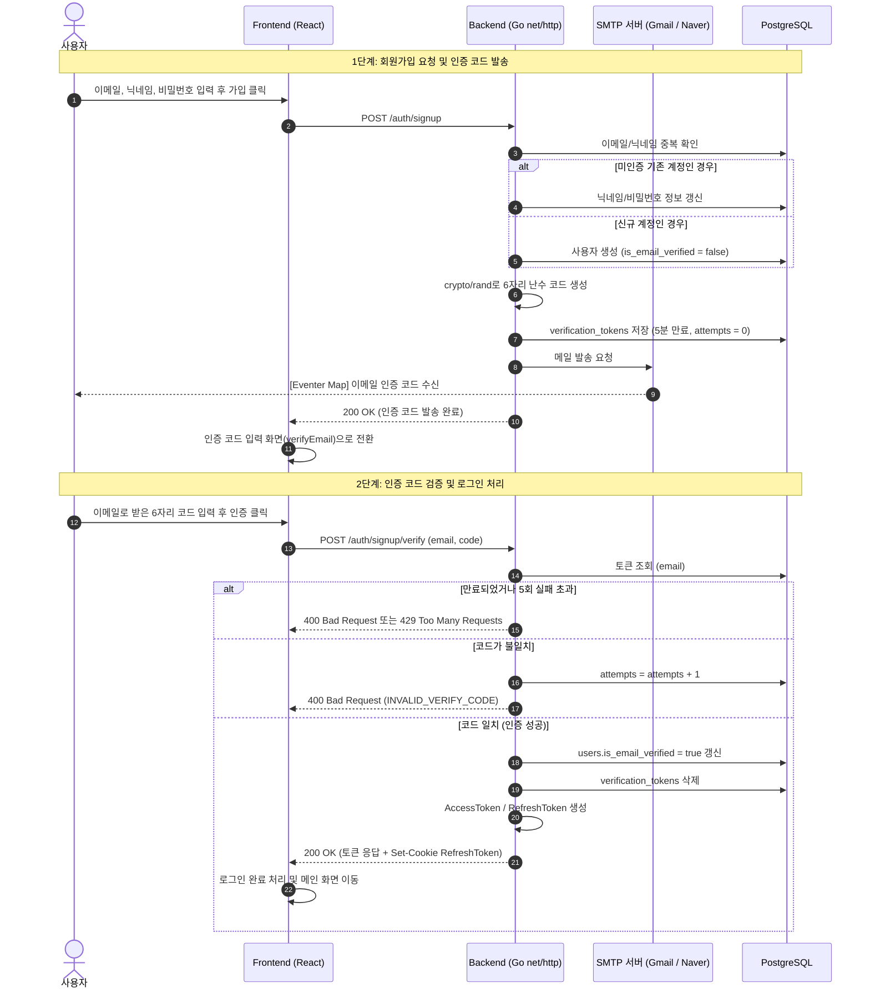
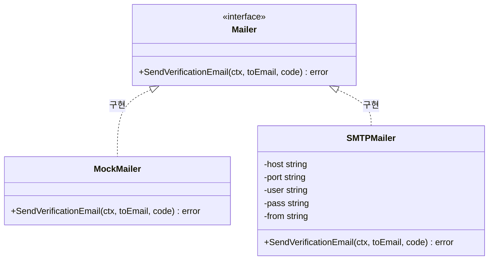

# 📧 이메일 인증 서비스 및 SMTP 설정 가이드

[⬅️ 홈으로 돌아가기](./Home.md) | [관련 문서: 인증 아키텍처 & OAuth 플로우](./AUTH_FLOW.md) | [API 상세 설계서](./API_SPECIFICATION.md)

이 문서는 Eventer Map의 **회원가입 이메일 인증 시스템**의 설계, 보안 원리, 메일러 아키텍처 및 SMTP 연동 방법을 상세히 다룹니다.

---

## 📌 1. 개요 및 요구사항

신규 유저의 이메일 소유권을 검증하고, 스팸/가짜 계정 생성을 방지하기 위해 6자리 난수 코드를 이용한 이메일 인증 체계를 적용했습니다.

### 핵심 정책 및 보안 규칙
| 항목 | 사양 / 정책 | 설명 |
| :--- | :--- | :--- |
| **코드 생성** | `crypto/rand` 6자리 난수 | 예측 불가능한 암호학적 안전 난수 (`000000` ~ `999999`) |
| **유효 기간** | **5분** (`time.Minute * 5`) | 5분이 경과한 코드는 만료되어 인증 불가 |
| **재전송 쿨다운** | **60초** (`time.Second * 60`) | 악의적/연속 메일 발송 남발 방지 (초과 시 `429 Too Many Requests`) |
| **시도 횟수 제한** | **최대 5회** (`maxVerificationAttempts`) | 무차별 대입(Brute-force) 공격 방지 (5회 실패 시 코드 재발급 필요) |
| **상수 시간 비교** | `subtle.ConstantTimeCompare` | 타이밍 공격(Timing Attack) 방어 |
| **미인증 로그인 차단** | `403 Forbidden` (`EMAIL_NOT_VERIFIED`) | 미인증 상태에서는 로그인 불가 (로그인 시도시 자동으로 재발송 및 인증 화면 이동) |
| **미인증 계정 재가입** | 정보 덮어쓰기 허용 | 코드를 입력하지 않고 창을 닫은 경우, 동일 이메일로 재가입 시 정보 갱신 후 새 코드 발송 |

---

## 🗺️ 2. 인증 시퀀스 다이어그램 (Sequence Diagram)



---

## 🗄️ 3. 데이터베이스 스키마

### `verification_tokens` 테이블
```sql
CREATE TABLE verification_tokens (
    email VARCHAR PRIMARY KEY,
    code VARCHAR(6) NOT NULL,
    expires_at TIMESTAMPTZ NOT NULL,
    attempts INT NOT NULL DEFAULT 0
);
```

### `users` 테이블 관련 컬럼
```sql
ALTER TABLE users ADD COLUMN is_email_verified BOOLEAN NOT NULL DEFAULT false;
```
> **참고**:
> - **Google 소셜 로그인** 사용자는 Google이 이메일을 이미 검증했으므로 가입 시 `is_email_verified = true`로 처리됩니다 (`000017` 마이그레이션으로 기존 계정 보정).
> - **X(Twitter) 소셜 로그인**은 기본 스코프에서 이메일을 수집하지 않으므로 `email = NULL`, `is_email_verified = false`로 가입되며 이메일 인증 코드 흐름을 거치지 않습니다 (이메일이 없으므로 비밀번호 설정도 비활성화됩니다). `X_REQUEST_EMAIL=true`로 확인된 이메일(`confirmed_email`)이 전달된 경우에만 `is_email_verified = true`가 됩니다.
> - 이미 X 계정에 연결된 확인 이메일이나 검증 완료 계정과 같은 이메일로는 로컬 재가입(`POST /auth/signup`)을 덮어쓸 수 없습니다 (`409 USER_EXISTS`).

---

## 🏗️ 4. 메일러(Mailer) 아키텍처 및 동작 원리

백엔드는 표준 `Mailer` 인터페이스를 기반으로 의존성 주입(DI)되도록 설계되어 있어 환경에 따라 구현체를 유연하게 교체할 수 있습니다.



### 1) `MockMailer` (개발 / 로컬 테스트용)
- `SMTP_HOST` 환경 변수가 설정되어 있지 않으면 자동으로 활성화됩니다.
- 외부 메일 서버로 연결하지 않고, **백엔드 서버 표준 출력 콘솔 로그**로 인증 코드를 출력합니다.
- 인터넷 연결이나 SMTP 계정 없이도 로컬에서 회원가입 E2E 테스트를 즉시 수행할 수 있습니다.

```text
========================================
[MOCK EMAIL] To: test@example.com
[MOCK EMAIL] Subject: Your Verification Code
[MOCK EMAIL] Body: Your verification code is: 849201
========================================
```

### 2) `SMTPMailer` (실제 발송용)
- Go 표준 라이브러리(`net/smtp`, `crypto/tls`)만을 사용하여 외부 의존성 없이 가볍고 안전하게 동작합니다.
- **포트별 통신 프로토콜 분기 지원**:
  - **Port 587 (STARTTLS)**: 일반 TCP 연결 후 `STARTTLS` 명령을 통해 TLS 암호화 세션으로 전환 (`smtp.SendMail` 활용).
  - **Port 465 (Implicit SSL/TLS)**: 처음부터 `tls.Dial`을 통해 암호화 터널을 수립한 뒤 SMTP 핸드셰이크 진행 (네이버 등에서 사용).

---

## ⚙️ 5. SMTP 환경 변수 설정 방법 (`backend/.env`)

실제 이메일 발송을 사용하려면 `backend/.env` 파일에 아래 환경 변수를 추가합니다.

```env
# ==========================================
# SMTP 이메일 발송 설정
# ==========================================
SMTP_HOST=smtp.gmail.com
SMTP_PORT=587
SMTP_USER=your_service_account@gmail.com
SMTP_PASSWORD=your_app_password
SMTP_FROM=your_service_account@gmail.com
```

### 환경 변수 상세 설명 (`backend/internal/mailer/smtp.go`)

| 환경 변수 | 역할 | 기본값 | 비어 있을 때의 동작 |
| :--- | :--- | :--- | :--- |
| **`SMTP_HOST`** | SMTP 메일 서버 호스트 주소 | 없음 | 실제 발송을 하지 않고 콘솔에 로그만 출력하는 **`MockMailer`로 전환** |
| **`SMTP_PORT`** | SMTP 서버 통신 포트 번호 | `587` | `587` 포트(STARTTLS)로 연결 |
| **`SMTP_USER`** | SMTP 서버 로그인(인증) 아이디 | 없음 | 서버 로그인 인증(`AUTH`)을 생략하고 발송 시도 |
| **`SMTP_PASSWORD`** | SMTP 서버 로그인 비밀번호 / 앱 비밀번호 | 없음 | 빈 비밀번호로 처리 |
| **`SMTP_FROM`** | 수신자에게 표시되는 '보낸 사람(From)' 이메일 | `SMTP_USER` 값 | `SMTP_USER` 값을 발신자 주소로 자동 사용 |

- **`SMTP_HOST`**: 실제 발송과 개발 Mock 모드를 전환하는 스위치 역할도 겸합니다. (예: `smtp.gmail.com`, `smtp.naver.com`, `email-smtp.ap-northeast-2.amazonaws.com`)
- **`SMTP_PORT`**: `587`(STARTTLS, 일반 연결 후 TLS 업그레이드)과 `465`(Implicit SSL/TLS, `tls.Dial`로 처음부터 암호화 연결)를 모두 지원합니다.
- **`SMTP_USER` vs `SMTP_FROM`**: Gmail/Naver처럼 이메일 계정 자체로 로그인할 때는 두 값이 동일하므로 `SMTP_FROM`을 생략할 수 있습니다. 반면 **AWS SES, SendGrid, Mailgun** 등은 로그인 ID(`SMTP_USER` = IAM/API Key ID)가 이메일 형식이 아니므로, 실제 표시할 발신 주소(`SMTP_FROM` = `noreply@yourdomain.com`)를 별도로 지정해야 합니다. (*참고: Gmail 등 일반 메일 계정은 스팸 악용 방지를 위해 로그인한 `SMTP_USER`와 다른 `SMTP_FROM`을 지정해도 원래 계정 주소로 덮어쓰거나 발송을 거부할 수 있습니다.*)
- **`SMTP_PASSWORD`**: Gmail이나 Naver 등 2단계 인증이 적용된 서비스는 일반 계정 비밀번호 대신 반드시 발급받은 **앱 비밀번호(애플리케이션 비밀번호)**를 입력해야 합니다.

### 🅰️ Google Gmail 연동 가이드 (권장: 포트 587)
일반 구글 계정 비밀번호는 보안상 직접 사용할 수 없습니다. 반드시 **앱 비밀번호**를 생성해야 합니다.

1. [Google 계정 관리](https://myaccount.google.com/) 접속
2. 좌측 메뉴의 **[보안]** 클릭
3. Google에 로그인 섹션에서 **[2단계 인증]** 활성화
4. 2단계 인증 페이지 맨 아래의 **[앱 비밀번호]** 클릭 (또는 검색창에 '앱 비밀번호' 검색)
5. 앱 이름(예: `EventerMap`) 입력 후 **[만들기]** 클릭
6. 화면에 나타나는 **16자리 비밀번호**(공백 제외)를 복사하여 `SMTP_PASSWORD`에 입력

```env
SMTP_HOST=smtp.gmail.com
SMTP_PORT=587
SMTP_USER=eventermap.official@gmail.com
SMTP_PASSWORD=abcd efgh ijkl mnop   # 공백 없이 16자리 입력
SMTP_FROM=eventermap.official@gmail.com
```

> 💡 **Tip**: 개인 계정 대신 `eventermap.official@gmail.com`과 같은 **서비스 전용 구글 계정**을 생성하여 등록하는 것을 강력히 권장합니다. (개인정보 보호, 수신자 신뢰도, 반송 메일 분리)

---

### 🅱️ Naver 메일 연동 가이드 (포트 465)
1. 네이버 메일 웹페이지 접속 ➔ 좌측 하단 **[환경설정]** 톱니바퀴 클릭
2. 상단 탭 **[POP3/IMAP 설정]** 클릭
3. **[IMAP/SMTP 설정]** 탭 선택 ➔ **'IMAP/SMTP 사용'**을 **[사용함]**으로 변경 후 저장
4. 2단계 인증을 사용 중인 경우 [네이버 보안 설정 > 애플리케이션 비밀번호]를 생성하여 등록

```env
SMTP_HOST=smtp.naver.com
SMTP_PORT=465
SMTP_USER=your_naver_id
SMTP_PASSWORD=your_naver_password_or_app_password
SMTP_FROM=your_naver_id@naver.com
```

---

## 🌐 6. 다국어(i18n) 지원

인증 시스템은 이메일 발송 본문/제목 및 에러 응답 모두 4개 국어(`ko`, `ja`, `en`, `zh`)를 지원합니다.

### 1) 인증 메일 다국어 템플릿 (`backend/internal/mailer/template.go`)
프론트엔드 Axios 요청 인터셉터에서 유저의 현재 UI 언어(`i18n.language`)를 `Accept-Language` 헤더에 주입하여 요청하며, 백엔드는 이를 파싱하여 해당 언어 템플릿으로 메일을 전송합니다. 비어있거나 매칭되지 않는 언어는 서비스 기본값인 `ja`(일본어)로 fallback됩니다.
또한 한글/일본어/한자 이메일 제목이 클라이언트에서 깨지지 않도록 **RFC 2047 Base64 인코딩**(`mime.BEncoding.Encode("UTF-8", subject)`)을 적용했습니다.

| 언어 | 메일 제목 (Subject) | 메일 본문 (Body) 예시 |
| :--- | :--- | :--- |
| **한국어 (`ko`)** | `[Eventer Map] 이메일 인증 코드` | 안녕하세요,<br/><br/>Eventer Map 이메일 인증 코드입니다:<br/><br/>  **123456**<br/><br/>인증 코드는 5분간 유효합니다. |
| **일본어 (`ja`)** | `[Eventer Map] メール認証コード` | こんにちは、<br/><br/>Eventer Mapのメール認証コードです：<br/><br/>  **123456**<br/><br/>認証コードの有効期限は5分間です。 |
| **영어 (`en`)** | `[Eventer Map] Verification Code` | Hello,<br/><br/>Here is your verification code for Eventer Map:<br/><br/>  **123456**<br/><br/>This code is valid for 5 minutes. |
| **중국어 (`zh`)** | `[Eventer Map] 邮箱验证码` | 您好，<br/><br/>这是您的 Eventer Map 邮箱验证码：<br/><br/>  **123456**<br/><br/>验证码有效期为5分钟。 |

### 2) 백엔드 에러 코드 (`backend/internal/handler/auth_handler.go`)
```json
{
  "error": "invalid or expired verification code",
  "code": "INVALID_VERIFY_CODE"
}
```

### 지원되는 에러 코드 목록
| Error Code | HTTP Status | 한국어 (`ko`) | 일본어 (`ja`) | 영어 (`en`) |
| :--- | :--- | :--- | :--- | :--- |
| `USER_EXISTS` | 409 Conflict | 이미 가입된 이메일입니다. | このメールアドレスは既に登録されています。 | This email is already registered. |
| `NICKNAME_EXISTS` | 409 Conflict | 이미 사용 중인 닉네임입니다. | このニックネームは既に使用されています。 | This nickname is already taken. |
| `INVALID_PASSWORD` | 400 Bad Request | 비밀번호는 8자 이상이며 영문과 숫자를 모두 포함해야 합니다. | パスワードは8文字以上で、英字と数字を両方含める必要があります。 | Password must be at least 8 characters and include both letters and numbers. |
| `INVALID_LOGIN` | 401 Unauthorized | 이메일 또는 비밀번호가 올바르지 않습니다. | メールアドレスまたはパスワードが正しくありません。 | Incorrect email or password. |
| `EMAIL_NOT_VERIFIED` | 403 Forbidden | 이메일 인증이 필요합니다. 인증 코드를 확인해주세요. | メール認証が必要です。認証コードを確認してください。 | Email verification is required. Please check your verification code. |
| `ALREADY_VERIFIED` | 400 Bad Request | 이미 인증된 계정입니다. | 既に認証済みのアカウントです。 | This account is already verified. |
| `RESEND_TOO_SOON` | 429 Too Many Req | 잠시 후 다시 요청해주세요. (60초 쿨다운) | しばらくしてから再度リクエストしてください。 | Please wait a moment before requesting a new code. |
| `INVALID_VERIFY_CODE` | 400 Bad Request | 인증 코드가 올바르지 않거나 만료되었습니다. | 認証コードが正しくないか、有効期限が切れています。 | The verification code is invalid or has expired. |
| `TOO_MANY_ATTEMPTS` | 429 Too Many Req | 인증 시도 횟수를 초과했습니다. 새 코드를 요청해주세요. | 認証の試行回数を超えました。新しいコードをリクエストしてください。 | Too many failed attempts. Please request a new code. |
| `EMAIL_REQUIRED_FOR_PASSWORD` | 400 Bad Request | 이메일이 없는 계정에서는 비밀번호를 설정할 수 없습니다. | メールアドレスが設定されていないアカウントではパスワードを設定できません。 | An email address is required to set a password. |

> X OAuth, 계정 연동/해제 및 탈퇴 재인증 관련 전체 API 에러 코드 목록은 [API 상세 설계서](./API_SPECIFICATION.md)를 참고하세요.

---

## 🚀 7. 향후 프로덕션 전환 시 권장사항 (AWS SES)

현재 구현된 `SMTPMailer`는 개발, 스테이징, 소규모 서비스에 매우 적합합니다.  
향후 서비스 규모가 확장되거나 AWS Lambda 배포 환경으로 전환할 경우, 다음과 같은 이점을 위해 **AWS SES(Simple Email Service)**로 확장하는 것을 고려할 수 있습니다:

1. **대량 발송 한도**: Gmail(하루 500통) 대비 거의 무제한 발송 가능.
2. **도메인 서명(DKIM / SPF)**: 스팸함 분류율을 낮추고 메일 신뢰도(전달율) 극대화.
3. **AWS SDK 연동**: `Mailer` 인터페이스를 구현하는 `SESMailer`를 생성하여 코드 변경 최소화로 교체 가능.

